# C2/C3 共享权威条件提交契约 v1（Draft）

> Joint Stage #43 / Workstream B #45；Epics #5/#6。基线 main `737ee9381ec0fdc57d26e605d557a844bdefd3d1`，2026-10-24（Asia/Shanghai）。
> 权威顺序：Rev4 → C0 → 决策协议及 Decision Artifact v2 / C1-A → 本实现细化草案。
> **仅设计/契约与离线检查。没有生产 issuer、CommitIfCurrent 实现、权限、见证或发送能力。Draft 不等于接受设计或关闭 CAS-9。**
> 冻结的 Rev4、C0/C0-R、C1、Decision v2 Schema、身份和 Golden 不变。若本细化与冻结约束冲突，阻断受影响实现，提交独立 Design Change；不得静默改上游。

## 1. 先冻结不变量与威胁

| ID | 必须成立的约束 | 来源/检查边界 |
| --- | --- | --- |
| A45-01 | 模型、人格、主持者、正文 created_by、签名正确都不能产生权限；决策选择与执行许可分开 | Rev4 §1/3/12；资格真伪需要在线 C2 |
| A45-02 | exact dependencies 闭合无环；资源/动作/委托逐跳不扩大，主体、根/规则/所有者版本精确绑定 | Rev4 §3/6/8；离线只查声明 DAG |
| A45-03 | round、ExecutionGeneration、context/authority/credential scoped epochs 独立；零 epoch 合法，generation 0 仅历史 | Decision v2 §2/7；不得将数字互代 |
| A45-04 | Verify 后不存在无条件写入窗口；同一事务锁后重验当前 owner/lease/版本/epochs/可信期限/全部依赖 | Decision v2 §4/6；真实锁语义 NOT RUN |
| A45-05 | Candidate 可消费、唯一 closure、EVIDENCE_CLOSED、三 Journal INPUT_CLOSED、高水位及 outbox/lineage 同时提交 | Decision v2 §4；不容许半关闭 |
| A45-06 | 撤销和 SEND_COMMITTED 在同一权威总序；撤销先则拒绝，发送先则保留在途事实 | Rev4 AUTH-01/02，§13.3；外部执行不等于本地提交 |
| A45-07 | 相同永久唯一键只能绑定一组精确输入/目标/写集/token；丢回复只查询原 lineage，不重做或续期 | Rev4 §12/13；Decision v2 §2/4 |
| A45-08 | witness 独立、耐久、可验真且仍有效；缺失/不可用/不能判定独立性则没有新受保护发送接受 | Rev4 §12–14；静态相等比较不证明独立部署 |
| A45-09 | 全部写者参与同一锁/顺序；副本、缓存、异步撤销通知、回滚旧软件不能扩大权限 | C1-A §2.7；未接入的旧写者阻断启用 |
| A45-10 | 身份、时间、依赖、提交结果未知均失败关闭；UNKNOWN 不是没有执行，不能自动重发 | Rev4 §12/13；保留未知状态 |

威胁包括：模型伪造 AUTH_OK；重放他人 token；同名主体不同身份源；未授权再委托/阈值替换；重排/重复 scope；先验权后撤销；owner A→B→A 的 ABA；锁等待期间 lease/回执到期；漏登记交付/依赖反向边；候选提前可见；提交后回复丢失；同键不同目标；见证回执伪造或同故障域；网关接管重放旧发送资格；撤销消息延迟；旧消费者/Generation 0 自动升级。

信任边界：Authority 的数据库、受信任身份/策略根和时间源正确；Egress 持有目标凭据和网络出口；独立 Witness 处于不同管理/签名/持久化故障域。恶意持凭据 Egress、同时失陷的根、MySQL 管理员破坏持久性均超出本地协议保证。必须通过部署权限和网络隔离单独验收，不能以本检查器证明。跨 trust domain 的权威顺序没有桥接证明时拒绝，禁止比较两个域的裸 sequence。

## 2. 类型化 API 与结果

可编译声明：[authority-api.go](../scripts/authority-api.go)。该文件与离线 Schema oracle 一起 `go run` 编译，只有 interface/类型，无任何 AuthorityContract 实现，也不被生产启动器导入。请求、token、expected state 以及所有新增 Intent/Plan/Transition 类型字段名与 [schema.json](contracts/authority-v1/schema.json) 必填字段做反射对齐。

```go
VerifyAuthority(ctx, VerifyRequest{
  ExactDependencies, Operation, Principal, CaseRound, ExecutionGeneration,
  ScopedEpochs, ProofID, ExactTargetID, UniqueKey, TrustedNow, SendIntent,
}, ExpectedState, CompleteWritePlan) VerifyResult
CommitIfCurrent(ctx, CommitRequest{
  UniqueKey, ExactTargetID, CommitToken, ExpectedState, CompleteWriteSet,
}) CommitResult
```

这是服务间的类型契约，不是暴露给模型的 JSON 工具。principal 从认证连接的主体和固定 identity source 取得，再与请求绑定；TrustedNow 由 Authority 的可信时间适配器注入。调用者填写的时间、principal_id、valid=true 或本地 Schema 通过都不能被相信。C2 读取不可变依赖原件、证明、资格登记和反向索引；C0 回读/Schema/语义检查来自对应冻结契约。请求字节/规模继承 C1-A；闭包至多 2048 节点、每节点父至多 64；超限拒绝而非截断。

本轮独立审阅修订将新 authority Draft 的 `write_set_digest` 改为 `plan_digest`、trace 的标签列表改为 typed `write_plan`；不修改冻结上游契约。`CompleteWriteSet` 参数现在携带的是 `CompleteWritePlan` 类型：封闭的 Admission / Quiescence / CandidateClosure / Send 提案，恰好一个非 null，其余显式 null，必须与 operation 相同。这些 null 仅属于新增 trace/计划契约，不更改冻结工件 nullable 规则。PreparedObject 只引用**已经存在的输入原件**，不能引用未来 closure/event/token/commit/lineage 原件。计划包含全部调用者可控参数、预期行状态、拟执行变更、outbox 事件种类和固定派生 profile；提交器回读输入，再按固定规则构造结果。不能用任意表名/SQL/标签授权写入，mutation_set 只是 typed plan 的必需变更投影，不能替代具体 transition 字段。

| Outcome | VerifyAuthority | CommitIfCurrent |
| --- | --- | --- |
| VALID | 仅产生短期 opaque token；不提交工件、不授予发送 | NEW 或 ORIGINAL + 完整不可变 CommitLineage；ORIGINAL 只读历史 |
| DENIED | 认证/资格/范围/同意/依赖不合格，或不支持操作/版本 | 非授权主体、写集不合格、见证不合格；无新写入 |
| REVOKED | 已排序的根/权限/依赖撤销 | 撤销在该提交前；回滚无新效果 |
| EXPIRED | 证明/身份/依赖/任务/时间窗已过期 | 锁后期限或 token/回执到期；回滚 |
| STALE | 当前 generation、owner/version/epochs 与期望不相符 | CAS/lease/网关代次不再当前；回滚 |
| CONFLICT | 唯一键已有不同绑定、争议或不合法 FSM | 目标/token/输入/写集冲突、pending/高水位不合格；回滚 |
| UNKNOWN | 可信来源、完整性或顺序不能确认 | 不可判定是否提交；先查原 lineage，禁止当作失败后重做 |

VerifyResult：VALID iff token 非空且 failure 为空；其他六码反之。CommitResult：VALID iff lineage 非空、failure 为空、disposition∈{NEW,ORIGINAL}；其他六码不携带新提交记录。UNKNOWN 可以返回查询定位信息，但不能返回发送能力。实现必须拒绝未知枚举/字段/版本。失败 reason 是固定机器原因，不让自由文本决定放行。STATIC_VALID 是离线检查输出，**不是**上述 VALID，也不能出现在生产 API。

CommitLineage 永久记录 commit_id、unique_key、target、token、request/expected-state/plan digests、完整 result refs、权威 sequence 和 UTC-ms。一个 submission 内所有子行引用同一 commit_id。查询原 lineage 允许使用历史 token ID 定位，但仍需当前认证的审计读取权限；不能把它转换为新的 VALID token、计票或发送。


### 2.1 无环提案与事务派生结果（B-01）

提交前必须按以下顺序构造，禁止实现者自行排除字段或求解自引用摘要：

```text
已固定输入原件 + typed transitions + mutation_set + outbox_kinds + derive/1
  -> CompleteWritePlan canonical bytes -> plan_digest
已固定 VerifyRequest（包括 send_intent）-> request_digest
已固定 ExpectedState -> expected_state_digest
三个 digest + 认证主体/当前状态 -> Verify 存储 opaque token_id（此时才分配 token）
锁内重验同三个 digest -> 分配 commit_id + sequence + UTC-ms
  -> derive/1 构造所有非-lineage 结果行（都绑定 allocation + 三个 digest）
  -> 各结果行 canonical bytes / result digest
  -> 最后构造 lineage（引用结果摘要和三个 digest，不引用自身）
  -> lineage digest 置于外包装，不放回 lineage 正文或 plan
```

`plan_digest = SHA256("magi:authority-plan:v1\n" || C0(plan))`；request/expected 分别复用本契约专属的 `magi:authority-request:v1\n`、`magi:authority-expected-state:v1\n` 域。不是给 C0 注册新 artifact type。`magi-authority-derive/1` 固定各变更由哪个 plan 字段派生，以及公共 allocation `{token_id,commit_id,authority_sequence,committed_at}` 的注入规则。固定候选/意图等工件**正文不被重写**，其存储提交元数据独立派生。

结果行含 `{kind,allocation,request_digest,expected_state_digest,plan_digest,derivation_profile,payload}`；其摘要使用 `magi:authority-result:v1\n` 域。payload 的映射为下节表和 `derive_example` 的封闭映射：admission/event/edges/三个 transition 使用对应输入/计划，quiescence 使用 fence/round/journals，closure 使用 candidate/fence/receipts/confirmations/journal 高水位，send 使用意图/请求绑定、action/quota/logical transition。唯一绑定由请求 key/target 派生；token 消耗由 allocation.token_id 派生；outbox 由已绑定 event kinds 与公共 allocation 派生。

lineage 含公共 allocation、三个 digest、derivation_profile、key/target 和所有非-lineage result_refs `{kind,id,digest}`，摘要使用 `magi:authority-lineage:v1\n` 域。所有子行只引用 commit_id/plan_digest，**不引用 lineage_digest**；lineage 的 result_refs 不包含自身。未来 token/sequence/time/lineage 摘要从未进入 plan preimage，因而不存在 `write_digest→lineage_digest→write_digest` 环。未知 profile 拒绝，不允许动态模板或调用者提供派生代码。

`test_B01_first_proposal_constructs_and_roundtrips_without_future_values` 对四种变体先删除全部 token/事务值计算计划摘要，再构造合成 token 声明、验证完整输入形状、注入事务 allocation、逐行回算结果和 lineage 摘要；改变未来 sequence 不改变三个提案摘要。此纯函数是**离线可构造性见证**，不实现 VerifyAuthority、不签发任何许可、不写数据库。

### 2.2 完整 transition 与结果派生清单（B-02）

| 变体 | 必需的已绑定计划 | 事务生成/变更的全部业务行（另加共同四项） |
| --- | --- | --- |
| JournalAdmissionPlan | admission/event 输入、全部依赖边、`HighWatermarkPlan(expected,next)`、`ProviderSettlementPlan(request_id,PENDING→APPLIED_VERIFIED,verification_ref)`、`PendingTransitionPlan(expected,next)` | admission、dependency_edges、journal_event、journal_high_watermark、provider_settlement、pending_transition |
| QuiescencePlan | 已分配 fence ID、round OPEN→QUIESCING、三个确定 Journal 的同向状态转移 | fence、round_state、journal_states |
| CandidateClosurePlan | 固定 candidate、三回执/确认、fence、三个 journal HWM/pending=0、round QUIESCING→EVIDENCE_CLOSED | candidate 的 COMMITTED 登记、closure、evidence_closed、三 journal 关闭行 |
| SendPlan | 已固定 Intent、ActionTransitionPlan(AUDIT_READY→SEND_COMMITTED，精确 gateway/generation/expected_version→next_version)、QuotaTransitionPlan(remaining 与 version CAS)、LogicalOperationPlan(VERIFY_EXISTING) | action_transition、quota、send_record、logical_operation_binding 的核验结果 |

共同四项是 **派生** lineage、token_consumed、unique_binding、outbox；只把种类与固定派生规则纳入计划，绝不要求预先存在这些输出原件。Journal HWM 与 pending 同一行可合为一次 SQL CAS，但两项都在 typed plan 中，不得遗漏任何一个。provider settlement 只在可信 provider 原件确认已应用后进入 APPLIED_VERIFIED；未知交付不减 pending、不生成可声称实际读取的 event。先于暴露的来源准入/权限及 provider pending 登记是 C1-C 前置持久事实，当前计划是对此确切请求的已验证交付进行 Journal 登记和结算；该前置协议未实现就不能运行本契约。

PREPARE 负责在 authority sequence 锁下创建永久 `(trust_domain,logical_operation_id)→business_parameter_digest` 映射：不存在时 INSERT，相同 digest 重用，不同 digest CONFLICT；与 ActionIntent+outbox 同事务。SEND 只 `VERIFY_EXISTING`，不得在发送时补建映射或改 business digest。PREPARE 的生产 typed write-set 仍属后续独立切片，本 Draft 不启用它。静态 negative 分别删掉 HWM、provider settlement、pending、action transition、logical binding 的 mutation 标签，必须拒绝；删掉具体必填 transition 本体则由 Schema 拒绝。

### 2.3 SEND 精确绑定与历史审计读取（B-03 / B-04）

SEND 的 VerifyRequest 必须有 `SendIntent`，其他三个操作显式为 null。该输入绑定 action_id、固定 intent ID/digest、最终编码的 HTTP 请求 digest、logical_operation_id 和业务参数 digest；相同 intent ID/digest 还必须存在于 exact dependency DAG。Commit 的 action、typed SendPlan、独立 witness 原件和准备好的实际请求必须全部匹配这同一 token-bound binding；action+witness 同时换成另一个 ID 或摘要仍拒绝，不能仅检查两份互相一致的未绑定声明。

`ReadOriginal(AuditReadRequest)` 是独立只读契约；trace 的 ORIGINAL/UNKNOWN lookup 分支代表它，不是使用旧 mutation token 重新调用发送。服务注入当前 audit 认证主体/固定身份源、当前审计政策决定与时间；`requester` 必须等于认证 principal，政策精确覆盖 case/round/key/target。audit 身份源/政策不可用为 UNKNOWN，拒绝/未认证/错身份源/越权为 DENIED，到期为 EXPIRED。确认 immutable lineage 完整性和其历史 issuer 映射后才能返回 ORIGINAL；历史 issuer 的当前 mutation credential 已被撤销不影响历史验真，不把恶意改写的 issuer 当作原记录。

audit gate 与旧 mutation 的主体、根、proof、lease、generation/epochs、token 期限分开。当前获准 auditor 可以读取已过期/撤销的旧 worker 的 lineage；旧 token 仅定位原件，不能证明当前读取权限。审计授权通过后仍只读原记录且禁止 resend。缺少 audit 认证不能因为历史内容一致而返回 STATIC_VALID；真实审计认证/政策引擎仍未实现，合成 audit_access 只检查这些声明约束。

## 3. 操作、责任与依赖 DAG

| 操作 | 输入产生者/认证主体 | C2 治理权威 | C3 / 存储提交者 | 消费者/边界 |
| --- | --- | --- | --- | --- |
| PUBLISH_ARTIFACT | 领域/人格维护者、Charter 有权主体 | 根、发布资格、owner/consent、权限链、撤销 | 精确目标发布登记、lineage | C1 / Charter / Manifest；未来 typed 写集未定义前拒绝 |
| JOURNAL_ADMIT | C1-C 受控注入/会话记录器 | 数据访问/披露/来源资格、依赖版本 | 原子 admission+event+反向边+提供方请求登记 | Journal/ReadSet；A 只做回读验证 |
| QUIESCE | C1-C 关闭协调器 | 当前任务/owner 和关闭资格 | 一次 fence+round+三 Journal 状态 | 只允许 fence 内终审包/确认继续登记 |
| CANDIDATE_CLOSE | 同一协调器 + 三受控角色确认者 | 各主体真实资格、共享包/确认/依赖有效 | 同一提交 closure+候选+三关闭+cutoff | E closure、ReadSet/终票 |
| SEAL_READSET | 受信任记录器 | 本人视图与完整性/依赖有效 | 唯一 seal/lineage | 未来 ballots；本版不实现写集 |
| SUBMIT_BALLOT / AGGREGATE_BALLOTS / PUBLISH_DECISION | 各 Persona / 聚合器 / 裁决器 | 各层独立验证，不沿用上游缓存许可 | 每层唯一键、当前 generation/epochs、发布 lineage | 后续独立版本切片，不由本 Draft 放行 |
| PREPARE_ACTION / ATTACH_WITNESS | 裁决器 / 回执处理器 | 执行许可、精确资源/参数/风险 | 意图+outbox；验签后 AUDIT_READY | 无发送资格；未来 typed 写集先审阅 |
| SEND_COMMIT | 经工作负载认证的唯一 Egress 实例 | FINAL CHECK：所有权限/依赖/期限/风险/额度/撤销 | 消耗资格+SEND_COMMITTED+网关绑定 | 只有该实例发送已绑定请求 |
| REVOKE / ROOT_ROTATE / OWNER_TAKEOVER | 独立治理/恢复渠道、持久 owner 管理器 | 旧有效规则授权变更；epoch/version 单调 | 与提交共用 sequence 锁；撤销及反向传播 outbox 原子 | 所有下游立即根据在线状态阻断；不是普通模型 API |

C2 拥有 trust roots、主体认证、委托/owner 规则、context/authority/credential 撤销源和版本。C3 Decision Authority 的单域 MySQL authority store 拥有总序、永久唯一键、token 状态和 commit lineage；C3 Egress 拥有可执行目标凭据、出口和网关代次。执行 runtime 仍拥有已有 owner/lease/ExecutionGeneration，未来桥接必须使**所有**claim/renew/terminal 写者参与本契约锁序，或给出等价原子证明；本 Draft 不改既有 runtime。Witness 不签执行许可，也不能替代 C2。

```mermaid
flowchart LR
  Root[先存治理根和身份源] --> Proof[精确主体与委托/同意证明]
  Domain[批准 Domain/Persona] --> Charter[Charter 正文及外置批准]
  Proof --> Charter
  Charter --> Manifest[Manifest 唯一轮次绑定]
  Manifest --> Admission[准入/依赖反向边/受控 Journal]
  Admission --> Fence[三方 QUIESCING fence]
  Fence --> Delivery[终审共享包和三回执]
  Delivery --> Candidate[Candidate 正文/ID]
  Candidate --> Confirm[三份外置确认]
  Confirm --> Closure[原子 Candidate+closure+三关闭]
  Closure --> Readset[completeness/ReadSet seal]
  Readset --> Ballots[独立终票提交/聚合/裁决]
  Proof --> Ballots
  Ballots --> Intent[ActionIntent PREPARE/outbox]
  Intent --> Witness[独立 Witness durable receipt]
  Witness --> Ready[ATTACH/AUDIT_READY]
  Ready --> Send[FINAL CHECK/SEND_COMMITTED]
  Proof --> Send
  Send --> Observe[远端观察/结果核验/结果见证]
```



所有箭头为下游对上游的精确版本依赖；外置批准/确认/closure/witness 引用先算出的目标，不回填祖先正文。反向边存储在外部同事务中，不能制造正文摘要环。撤销沿 source→会话→ReadSet→票→裁决→待发送动作传播；未能证实闭包完整时保守失效并停止污染会话，不把异步通知送达当作阻断前提。

## 4. 根、scope、期限与 token 决议

| 决议 | 固定选择/理由 |
| --- | --- |
| D45-01 token 生命周期 | 最长 5000 ms，是新增工程上限，非 Rev4 原文。expires_at=min(issued_at+5000ms, identity/proof/全部依赖/lease/任务/操作窗口/见证的最早上界)。半开区间；等于到期即拒绝。过期只可查询原提交，重验证发新 token 仍不能替换永久唯一键。参考域写权限证明仍最长 5 分钟，短 token 不延长它 |
| D45-02 token 内容与重放 | opaque server-side 256-bit 随机 ID，存储精确认证主体/身份源、operation、case/round、target、unique key、proof/root/policy/全部依赖、generation、scope/epochs、expected-state/plan digests 与 derivation profile、期限和版本。连接身份与存储 token 交叉核验；不能转移为 bearer。Verify 接收无未来输出的写入计划/期望状态提案，Commit 必须同 plan_digest / expected_state_digest；不能要求调用者提交含未来 sequence/token 的最终行字节。token 消耗与完整写集同事务；同 token 跨键/目标/操作拒绝 |
| D45-03 时间与顺序 | UTC 毫秒来自同一经监测的 Authority DB UTC 时钟，权威时间不可用/回跳超出已批准误差策略则 UNKNOWN。UTC 用于期限；sequence 用于撤销/提交先后，禁止通过时间戳打平局。锁后独立语句读取时间，不能用锁等待前的 NOW。时间适配器/误差配置未验收前不启用 |
| D45-04 scopes 集合 | `(kind,scope_id)` 去重，按 NFC UTF-16 code unit 排序；kind 固定 AUTHORITY/CONTEXT/CREDENTIAL。每类至少一个，受影响全部 scope 必须闭包完整，不是仅单资源。按同 kind+scope 比较 epoch；零 epoch 是显式值，缺项不补零。所有键/依赖集合稳定排序，事件按 sequence，不通过排序改变事件顺序 |
| D45-05 撤销与 ABA | epoch、owner generation、各权威 row_version 单调不回退/复用；超安全整数上限拒绝而非回绕。删除再建不得重用旧 scope 身份/版本。根/凭据轮换提升对应 credential/authority epoch，旧 token 立即 STALE/REVOKED；任何安全撤销不可恢复旧 ID，纠正需新原件/新轮 |
| D45-06 原子性 | 单 trust domain、单 InnoDB authority 事务是本版选择；所有写者共锁 sequence 行。跨服务异步消息/补偿不等价。无法接入同事务时该能力 BLOCKED，先作新的协议/证明审阅 |
| D45-07 witness 独立性 | 独立部署/管理身份、独立持久化账号与签名根；gate 和模型不能写见证存储或取得其私钥。只使用 deployment authority 固定的域/键映射和独立 checkpoint。与 Egress 同主机控制面无法排除共同失陷，不算验收独立性。absence/partition/unknown=UNKNOWN；坏签名/错摘要/不独立=DENIED；过期=EXPIRED |
| D45-08 capabilities | 部署权威签署的静态能力清单，模型/工件不声明能力。所有参与者的版本交集才允许新模式，缺一即阻断，不降级为旧版或 synthetic AUTH_OK |

逐跳权限链：从带外安装且先于工件存在的根开始；固定身份源/映射版本、签发者、受托主体、resource set、operation set、not_before/expires_at、delegable、credential scope/epoch、签发序号。子 resource/operation 是父的子集；主体匹配认证身份；父无 delegable 则禁止再委托；拒绝循环、缺跳、无资格签发者、冲突委托和来源未知。真正的密码封装/密钥格式是后续独立实现验收项，本版字段声明不提供 AuthorityProof 生产签发器。

所有者集合/资源映射有固定版本。OWNER_ALL 默认；OWNER_THRESHOLD 只能采用事先全体共同批准的精确 threshold，按唯一不同主体计数，重复签名不增票；SINGLE_DELEGATE 必须唯一有效且可追溯，冲突暂停。执行授权者可不同于决策所有者。仲裁只能解释/缩小既有授权，不能创造许可。

bootstrap：独立部署治理者用带外双人核验安装根指纹、身份源版本、恢复渠道和阈值政策；记录 genesis checkpoint，不接受第一个请求自封根。正常 rotation 由当前有效旧根/门槛批准，原子安装新根、提升相关 epoch、记录旧根停用 sequence。旧根不可用/疑似失陷时冻结域、停止新提交/发送，走预登记独立恢复 quorum，建立新 trust-domain incarnation 和 checkpoint，核对旧代次已无法写入/发权；不由模型、普通管理员称号或失陷旧根单独恢复。旧历史保留，跨 incarnation 未重核验的依赖一律不可权威消费。

## 5. MySQL 精确锁集、提交点与事务草图

这是 **MySQL 8.4/InnoDB 未来实现规范，NOT RUN**，不是 migrations、存储过程或既有表声明。表名 `a45_*` 是隔离设计名字，绝不伪装已存在。使用 primary、READ COMMITTED + 显式 FOR UPDATE；所有读权威状态走 primary，不能从副本验权。MySQL 文档依据：InnoDB locking reads、deadlocks（consistent order）、date/time functions（NOW 在语句起点取时）；本文要求先取得全部锁再起时间语句。静态 checker 只核对声明顺序和写集，不解析/执行 SQL。

最小未来关系与唯一约束：

| 表/主键 | 必须持久字段或索引 |
| --- | --- |
| a45_sequence `(trust_domain)` | last_sequence、linearized_at、incarnation；预先建立，不允许调用者创建信任域 |
| a45_epoch `(trust_domain,kind,scope_id)` | epoch、revoked、row_version；删除/插入均受同序列锁保护 |
| a45_owner `(trust_domain,case_id)` | owner_id、execution_generation、lease_until、active、row_version；映射持久 runtime claim |
| a45_round `(trust_domain,case_id,round)` | manifest_id、state、fence_id、candidate_id、cutoff、version；唯一轮次不随 generation 解开 |
| a45_journal `(trust_domain,case_id,round,role)` | manifest_id、state、fence、high_watermark、close_high_watermark、pending_count |
| a45_provider_delivery `(trust_domain,provider_request_id)` | status、verification_ref、JournalKey；先于暴露持久 PENDING，未知不转为已验证 |
| a45_dependency `(trust_domain,node_id)` | digest、version、valid_until、revoked、source/proof/policy refs；外部反向边唯一 `(parent,child,edge_kind)` |
| a45_token `(trust_domain,token_id)` | request/expected/plan digests、subject、state、expires_at、commit_id；ID 不复用 |
| a45_unique `(trust_domain,operation,unique_key)` | target_id、token_id、三个 digests、commit_id；原内容永不覆盖 |
| a45_witness `(trust_domain,action_id,intent_digest)` | 独立签名回执原件、witness_domain/key/checkpoint/sequence、valid_until |
| a45_gateway `(trust_domain,gateway_id)` | generation、lease_until、active、identity source/credential refs |
| a45_action / a45_quota / a45_logical_operation | action 状态/row_version/intent；quota remaining/version；logical_operation_id 永久绑定业务参数 digest；原生行也必须锁定 |
| a45_logical_binding_check `(commit_id,logical_operation_id)` | SEND 对已有永久映射的派生核验结果，绑定本次 plan_digest；不替换永久映射 |
| a45_lineage / a45_outbox | commit_id 全部引用/sequence/time；outbox 唯一 `(commit_id,event_kind,ordinal)` |

admission 唯一键 `(case,round,role,controlled_session_id,provider_request_id,injection_id)`，同 delivery 重试不新增 event；Journal event 主键含 role+local_sequence。Candidate 唯一 `(case,round)`；seal/ballot 继承 Decision v2 `(case,round,manifest,persona)`。send 唯一 action_id；另永久 logical_operation_id→业务参数 digest 的去重登记，换 action_id 不能绕过业务操作去重。key 在服务内由 typed tuple 编码，不能相信调用者拼接的字符串是否唯一。

**全局锁序**：sequence → epochs 按 `(kind,scope_id)` → owner 按 case → round → journals 按 role → dependencies 按 node ID（包括 root/proof/policy/owner-map 原件）→ token → unique key → witness → gateway。多行逐个确定键锁，禁止依赖 IN/ORDER BY 的执行计划猜测实际锁序。预先准备所有完整闭包和写目标锁；缺行在 sequence 锁下判定不存在/插入，防止 phantom 放行。所有 revoke、root rotation、scope insert、credential rotate、generation takeover/renew、admission、closure、seal、ballot、send 都遵守；事务内禁止 provider/network RPC。死锁/锁超时先完整回滚再有限重试同键；commit 网络丢失则 UNKNOWN，不走盲重试。

公共提交前奏（`:parameters` 均为认证服务内部参数；多 scope/node 时展开单键语句，不省略任何受影响键）：

```sql
SET TRANSACTION ISOLATION LEVEL READ COMMITTED;
START TRANSACTION;
SELECT incarnation,last_sequence FROM a45_sequence
 WHERE trust_domain=:domain FOR UPDATE;
-- Verify pinned incarnation and all-writer capability gate; absent => rollback UNKNOWN.
SELECT epoch,revoked,row_version FROM a45_epoch
 WHERE trust_domain=:domain AND kind=:kind AND scope_id=:scope FOR UPDATE;
-- Repeat for every exact scope in canonical order; absent => rollback DENIED.
SELECT owner_id,execution_generation,lease_until,active,row_version FROM a45_owner
 WHERE trust_domain=:domain AND case_id=:case FOR UPDATE;
SELECT manifest_id,state,fence_id,candidate_id,cutoff,version FROM a45_round
 WHERE trust_domain=:domain AND case_id=:case AND round=:round FOR UPDATE;
SELECT state,fence,high_watermark,close_high_watermark,pending_count FROM a45_journal
 WHERE trust_domain=:domain AND case_id=:case AND round=:round AND role=:role FOR UPDATE;
-- Repeat exact balthasar,casper,melchior keys for closure/quiesce; relevant key for admission.
SELECT digest,version,valid_until,revoked FROM a45_dependency
 WHERE trust_domain=:domain AND node_id=:node FOR UPDATE;
-- Repeat entire dependency/proof/root/policy closure, never partial set.
-- JOURNAL_ADMIT native provider request is locked in this dependency phase:
SELECT status,verification_ref FROM a45_provider_delivery
 WHERE trust_domain=:domain AND provider_request_id=:provider_request FOR UPDATE;
-- SEND native action/quota rows are locked during this dependency phase, in exact ID order:
SELECT state,intent_digest,row_version FROM a45_action
 WHERE trust_domain=:domain AND action_id=:action FOR UPDATE;
SELECT remaining,row_version FROM a45_quota
 WHERE trust_domain=:domain AND quota_id=:quota FOR UPDATE;
SELECT state,expires_at,commit_id,request_digest,expected_digest,plan_digest
 FROM a45_token WHERE trust_domain=:domain AND token_id=:token FOR UPDATE;
SELECT target_id,token_id,request_digest,expected_digest,plan_digest,commit_id
 FROM a45_unique WHERE trust_domain=:domain AND operation=:op AND unique_key=:key FOR UPDATE;
-- Unique-key phase also locks the permanent logical-operation binding on SEND:
SELECT business_parameter_digest FROM a45_logical_operation
 WHERE trust_domain=:domain AND logical_operation_id=:logical_operation FOR UPDATE;
-- SEND also locks exact witness then gateway; other operations have no such row.
SELECT receipt_bytes,valid_until FROM a45_witness
 WHERE trust_domain=:domain AND action_id=:action AND intent_digest=:intent_digest FOR UPDATE;
SELECT generation,lease_until,active FROM a45_gateway
 WHERE trust_domain=:domain AND gateway_id=:gateway FOR UPDATE;
SELECT UTC_TIMESTAMP(3) AS locked_now;
```

所有实际 SELECT 的完整列包含验权需要的字段，上面仅显示关键列；实现不得按草图列缺省其他字段。在独立当前 audit gate 通过后，已提交同键的 exact target/token/request/expected/plan 三个 digest 全同：在当前审计读权限下返回原完整 lineage，ORIGINAL 路径不检查旧 token 是否过期来重授许可；不同即 CONFLICT。数据库故障或找不到完整 lineage => UNKNOWN。新 mutation 路径另行确认 token 为 UNUSED、issuer/认证主体一致、服务器存储的整个 transcript 相同，重算输入原件/完整计划/派生 profile，比较 owner/generation/version/所有 epochs/lease。锁后重新核对 identity/proof/dependency/预算/窗口/风险/同意/回执；变更或未知则回滚。

**线性化语句**：准备且核验完整计划后，持有全部锁，在下列条件 UPDATE 中再次取语句起点时间。`:deadline` 是所有适用上界的最早值（包括 token/lease/证明/数据/任务/操作/见证），`:not_before` 是全部下界最大值。新鲜性另用可包含上界 `:inclusive_freshness_limit`（观测时间+已批准 max_age_ms），不能塞入半开 `:deadline` 而错误拒绝等于上限；非适用操作显式无该条件。UTC 不可判定则不执行。`ROW_COUNT()` 必须为 1，0 则回滚并分类期限/STALE。此 UPDATE 的 sequence 是条件提交的线性化点，只有后续 COMMIT 成功才生效；外界直到完整事务提交才能读取 NEW。time 比较与序号分配在同一语句，不能用早先 locked_now 延长期限。

```sql
UPDATE a45_sequence
 SET last_sequence=last_sequence+1, linearized_at=UTC_TIMESTAMP(3)
 WHERE trust_domain=:domain AND incarnation=:incarnation
   AND last_sequence=:locked_sequence AND last_sequence<9007199254740991
   AND UTC_TIMESTAMP(3)>=:not_before AND UTC_TIMESTAMP(3)<:deadline
   AND UTC_TIMESTAMP(3)<=:inclusive_freshness_limit; -- when freshness applies
-- Exactly one affected row, then SELECT last_sequence,linearized_at in same tx.
-- Write the operation-specific ALL rows below + lineage + token consumption + outbox.
-- COMMIT last. Any failed insert/CAS/affected-row assertion => ROLLBACK ALL.
```

authority row_version 是相关权限/状态版本，**不是** last_sequence；发 token 自身的序号增长不会让 token 自己失效。每一相关可变行版本和 epoch 需逐项比对。all-writer 锁使核验后到线性化语句间不能插入撤销；锁后时间只解决期限，不能替代锁/版本。事务持锁不做 RPC；外部不可变证明必须先获取，锁内按可信登记/epoch/期限/原件再核验，来源不能确认即 UNKNOWN。

### 5.1 Journal 准入、交付与三方 quiescence

JOURNAL_ADMIT 的输入必须先有暴露前来源准入/访问资格、完整依赖和持久 provider/session PENDING 登记；这里提交的是已应用交付的 Journal 事件与 pending 结算，不能把此后置结算当作首次暴露许可。可信 provider 原件无法确认 APPLIED_VERIFIED 时保留 PENDING，不追加假读取或删记录。前置准入与持久 adapter 顺序/恢复仍 BLOCKED C1-C；未实现前不能调用本协议产生实际读取声明。

```sql
-- Common locks and checks; validate exact JournalKey/Manifest/role/generation.
-- OPEN: ordinary qualified material allowed.
-- QUIESCING: only FINAL_SHARED/CONFIRMATION with the exact persisted fence.
-- INPUT_CLOSED: only exact pre-cutoff admitted node/version REREAD, no new node.
INSERT INTO a45_admission (...) VALUES (...,:exact_node,:node_digest,:sequence,:commit_id);
INSERT INTO a45_dependency_edge (...) VALUES (...); -- entire parent + reverse edge set
INSERT INTO a45_journal_event (...) VALUES (...,:locked_hwm+1,:provider_request,:commit_id);
UPDATE a45_provider_delivery SET status='APPLIED_VERIFIED',verification_ref=:exact_verification_ref
 WHERE trust_domain=:domain AND provider_request_id=:provider_request AND status='PENDING';
-- exactly one row; trustworthy applied-delivery proof is a fixed plan input.
UPDATE a45_journal SET high_watermark=high_watermark+1,pending_count=pending_count-1
 WHERE trust_domain=:domain AND case_id=:case AND round=:round AND role=:role
   AND high_watermark=:locked_hwm AND state=:expected_state AND fence=:expected_fence
   AND pending_count=:expected_pending AND pending_count>0;
-- exactly one row; HWM and pending transitions both bound by the plan, same CAS/tx.
```

事件本地序号是连续前缀；authority_sequence 仅供全域排序，两者不混用。INPUT_CLOSED 的合法重读新增 ReadEvent，但 node 的原 admission_sequence 必须 `<=cutoff`，不得把后序 node 换名为缓存重读。

QUIESCE 取三 Journal 锁，检查全是 OPEN、Manifest 唯一绑定/owner 当前；使用 Verify 前计划已绑定的不可复用 fence_id（此前不得消费），round 和三 Journal 同事务更新为 QUIESCING，记录 fence sequence/outbox/lineage。允许既有 in-flight 结算；普通新材料从此拒绝。关闭前重新取锁检查所有 pending 为 0，包括提供方交付、确认上下文交付和依赖边；unknown/失败阻断关闭。不能在 quiesce 时清零 pending。

### 5.2 Candidate + closure：唯一关闭提交

三份共享交付回执和三确认的真实性/角色/会话/proof/Manifest/shared package/fence/generation/epochs，以及 `injected_at <= verified_at <= frozen_at <= confirmed_at <= linearized_at` 全核对。确认恰好三个固定角色且都指向同一精确 Candidate ID。ROLLOUT-LAB 的 source observation freshness 为 30000ms，等于上限允许；不能拿重发/回执时间刷新它。所有这些期限/新鲜性在 sequence UPDATE 时适用。

```sql
-- Common locks: all three journals + round + complete dependencies/receipts/confirmations.
-- assert round.state=QUIESCING, each journal QUIESCING with SAME fence;
-- assert each pending_count=0, provider ledgers and reverse edges settled;
-- assert unique (case,round) unbound OR return exact original lineage.
INSERT INTO a45_candidate (...) VALUES (...,:candidate_id,'COMMITTED',:commit_id);
INSERT INTO a45_closure (...) VALUES (...,:candidate_id,:fence,:sequence,
 :balthasar_hwm,:casper_hwm,:melchior_hwm,:receipts,:confirmations,:commit_id);
UPDATE a45_round SET candidate_id=:candidate_id,state='EVIDENCE_CLOSED',cutoff=:sequence,version=version+1
 WHERE trust_domain=:domain AND case_id=:case AND round=:round
   AND version=:expected_version AND state='QUIESCING' AND fence_id=:fence;
UPDATE a45_journal SET state='INPUT_CLOSED',close_high_watermark=high_watermark
 WHERE trust_domain=:domain AND case_id=:case AND round=:round AND role=:role
   AND state='QUIESCING' AND fence=:fence AND pending_count=0 AND high_watermark=:hwm;
-- execute for EACH role; all four UPDATE assertions exactly 1, else rollback.
INSERT INTO a45_unique (...) VALUES (...,:candidate_id,:token,:three_digests,:commit_id);
UPDATE a45_token SET state='CONSUMED',commit_id=:commit_id
 WHERE trust_domain=:domain AND token_id=:token AND state='UNUSED';
-- exact 1; insert full immutable lineage and EVIDENCE_CLOSED outbox in same tx.
COMMIT;
```

禁止从 prepared candidate 表或 outbox 未完成记录消费候选；只有 whole-commit lineage/closure 与三个关闭记录同提交可读。Crash-before-COMMIT 全回滚；COMMIT 成功但回复丢失只按原键查询。closure/ReadSet 继续引用既有 Decision v2 字段，不增加 C0 类型或改冻结正文。

### 5.3 独立 witness 与受保护 send

PREPARE 原子持久化不可变 ActionIntent + witness-request outbox，状态 PREPARED→WITNESS_PENDING；无发送权。独立 Witness 按 `(action_id,intent_digest)` 幂等持久追加，签名含其序号/checkpoint/received_at/valid_until；同 action 不同 digest 拒绝告警。ATTACH 核对独立部署映射、签名、原始意图、精确 bytes、TTL/key epoch 后在 authority 事务转 AUDIT_READY。网关在实际发送就绪后才 FINAL CHECK；witness receipt 不是执行许可。

```sql
-- Common locks including action/intent in dependencies, witness row, gateway.
-- assert authenticated egress identity == pinned gateway; generation/lease current;
-- assert action AUDIT_READY, current permissions/risk/budget, exact request encoded;
-- assert valid durable independent receipt, policy/witness-key epoch/checkpoint current;
-- assert PREPARE-created logical binding exists with same business-parameter digest;
-- bind VERIFY_EXISTING result to this commit_id; SEND never creates/rebinds permanent mapping.
-- locked current quota_id/vendor/version/remaining exactly equals the token-bound quota row.
-- Common conditional sequence UPDATE is the SEND_COMMITTED linearization point.
UPDATE a45_action SET state='SEND_COMMITTED',send_sequence=:sequence,
 gateway_id=:gateway,gateway_generation=:gateway_generation,commit_id=:commit_id,row_version=:next_action_version
 WHERE trust_domain=:domain AND action_id=:action AND intent_digest=:intent_digest
   AND state='AUDIT_READY' AND row_version=:expected_action_version;
UPDATE a45_quota SET remaining=remaining-:amount,row_version=:next_quota_version
 WHERE trust_domain=:domain AND quota_id=:quota_id AND row_version=:quota_version
   AND remaining=:quota_remaining AND remaining>=:amount;
-- quota/action rows are part of prelocked dependencies; affected rows exactly 1 each.
INSERT INTO a45_send_record (...) VALUES (...,:exact_request_digest,:gateway,:gateway_generation,:sequence,:commit_id);
INSERT INTO a45_logical_binding_check (...)
 VALUES (:commit_id,:logical_operation,:business_parameter_digest,:plan_digest,'VERIFIED_EXISTING');
-- unique binding + token consumption + immutable lineage + outbox, all same tx.
COMMIT;
-- Only exact authenticated gateway from NEW lineage may perform exact encoded SEND.
-- ORIGINAL does not grant SEND. Disable redirects/request mutation/credential disclosure.
```

撤销事务也先取同 sequence 锁，提升相关 epoch/version，写 REVOKED+反向失效+outbox/lineage，并分配序号。若 revoke_sequence<send_sequence，该 send 不可能通过当前校验；若 send_sequence<revoke_sequence，动作已在途，保存接受历史并尽力取消后续步骤，不承诺阻止远端旧请求。相等序号非法（各提交唯一）；仅静态负例使用 <= 表示必须拒绝的无效顺序声明。

SEND_COMMITTED 后崩溃/网关失权先转 OUTCOME_UNKNOWN 并核对；接管实例不继承旧发送资格。FENCED_IDEMPOTENT：远端排除旧代次且按同 logical_operation_id 查询/去重，重新发送必须新 action_id/当前授权/见证，业务参数不变；IDEMPOTENT_ONLY：领域明确接受本地撤销不能挡在途请求的边界；UNFENCED_NONIDEMPOTENT：未知后禁止自动重试，默认 R2/R3 禁止，参考域所有写禁止。NOT_FOUND 不单独证明未执行。只在核验器确认远端效果后 VERIFIED，结果见证 outbox 不重发业务操作。

## 6. FSM、崩溃、ABA 与撤销交错

```text
Token: UNUSED -> CONSUMED; UNUSED -> EXPIRED / INVALIDATED
       CONSUMED -> 只读同 lineage；任何终结状态不能恢复 UNUSED
Journal: OPEN -> QUIESCING(fence) -> INPUT_CLOSED -> SEALED
         每阶段可 INVALIDATED；INPUT_CLOSED 仅受控旧节点重读
Round: BOUND -> QUIESCING -> EVIDENCE_CLOSED(candidate+closure)
       -> seals/ballots/decision 后继；决定性变化 INVALIDATED -> 显式新 round
Action: PREPARED -> WITNESS_PENDING -> AUDIT_READY -> SEND_COMMITTED
        -> RESPONSE_RECEIVED / OUTCOME_UNKNOWN -> VERIFIED / FAILED
        pre-send 可 REVOKED/EXPIRED/CANCELLED/CONTEXT_INVALIDATED；不得覆盖 send 历史
```

| 交错/故障 | 必须观察到的结果 | 静态 fixture / 真实证据 |
| --- | --- | --- |
| V(token epoch3)→R(epoch4)→C(old token) | STALE/REVOKED，无新候选/发送接受 | epoch_revoke_after_verify；真实并发 NOT RUN |
| V(owner A,g7,v11)→B(g8)→A(g9,v13)→C | owner 字符串恢复仍拒绝；generation/version 不恢复 | owner_ABA_new_generation / owner_ABA_new_version；真实接管 NOT RUN |
| 等待锁→lease/token 恰到期→取得锁→C | 锁后时间拒绝，半开区间 | lease_lost_while_waiting_for_lock / expired_at_boundary |
| fence 后普通材料/错 fence 终审包到达 | CONFLICT；旧 pending 不删，正确 fence 终审才允许 | ordinary_after_fence / final_shared_wrong_fence |
| 最后一确认尚 pending→C | CONFLICT，候选不可消费 | pending_injection_blocks_close；provider BLOCKED |
| 三关闭写到第1/2项→kill | 整体回滚或整个 lineage 已提交；无部分可读 | partial_close_write_set / early_candidate_visibility；kill MySQL NOT RUN |
| C成功→回复丢失→原键原token原写集查询 | ORIGINAL，只读原 closure；不新 close、不续期、不发 | reply_loss_original / original_read_after_expiry |
| 原唯一键→换 target/写集/主体/操作再试 | CONFLICT 或 TOKEN_BINDING；不能覆盖 | unique_key_other_target / token_replay_other_write_set / token_* |
| witness 缺席/分区、回执未耐久、同域或坏签名 | UNKNOWN/DENIED，AUDIT_READY 不等于 SEND | witness_absent / witness_not_durable / witness_not_independent |
| AUDIT_READY→revoke(seq20)→send(seq21) | REVOKED，无新接受 | revoke_precedes_send；真实序列 NOT RUN |
| send(seq21)→revoke(seq22)→远端执行 | 保留在途接受；撤销不倒写未发 | send_precedes_revoke_inflight；远端 NOT RUN |
| SEND_COMMITTED→kill/接管→网络结果未知 | UNKNOWN；不把旧 qualification 交给新网关 | send_committed_crash_unknown / gateway_takeover_old_qualification |
| remote已执行→回复丢失→盲发非幂等 | 禁止，核对/人工处理 | nonidempotent_unknown_blind_retry；实际网络 NOT RUN |
| source/reverse-index缺失→closure/ballot/send | 保守失效；无“未见撤销所以有效” | missing_dependency / missing_reverse_edge；传播 BLOCKED |

静态 checker 对声明字段执行约束，不生成实际 schedules，不提供模型检查穷举结论，也不能证明数据库锁或上述 kill 恢复。每个未来实现必须以可观测屏障和真实存储分别复现这些交错。

## 7. 能力协商、迁移与兼容矩阵

能力清单至少列出 `(contract=magi-authority/1, operation, artifact_type,schema_version,canonical_profile,readset_version,root_incarnation,epoch_kinds,commit_protocol,witness_policy,remote_mode)`；包含固定 risk-record `2.1/magi-risk-input/1`、C0 `magi-cj/1`、input artifacts v1、Decision v2。未知枚举/版本/操作拒绝。不把本 trace schema 称为 AuthorityProof/ActionIntent 的生产格式。

| 参与者/记录 | 读/验证 | 新权威写/消费条件 | 当前状态 |
| --- | --- | --- | --- |
| A #42 ReadSet read adapter | 保留精确原始字节、v2 身份/闭包；输出离线检查 | 不签 token、不 claim actual provider read；实际准入/读取依赖 C1-C+C2 | 与 A 并行，无实现依赖 |
| B #45 issuer/commit contract | 本文 typed fields/静态 declarations | C2 根/认证/撤销、全部写者原子桥接、真实 MySQL 验收后独立实现 | 本 Draft；无 issuer/commit |
| E final closure | 消费冻结 Candidate/receipt/confirmation/closure ref | CANDIDATE_CLOSE 全写集/三方 provider settlement 与唯一 commit lineage | BLOCKED merged A/B 及真实记录器 |
| future seal/ballots/聚合/裁决 | 各自读完整依赖，独立 Verify | 新操作 typed write-set + schema/version 审阅 + 当前 authority commit，不能用上游绿灯替代 | BLOCKED 后续切片 |
| protected ActionIntent/send | 原始编码请求、依赖、独立回执、逻辑操作映射 | 全体 capabilities、独立 Witness、唯一 Egress、FINAL CHECK、远端适配器已验收 | BLOCKED C2/C3/部署 |
| Generation 0 / v1 缺依赖历史 | 原字节/原算法只读，明确 LEGACY/NON_AUTHORITATIVE | 一律不能自动补 generation/epoch/证明后进入权威模式 | 保留历史身份 |
| v2 artifact + 旧消费者 | 可展示为不支持的历史原件 | 不降写版本、不删字段、不回退旧协议 | 拒绝权威使用 |
| 新 Domain/Persona 普通发布 | 新任务固定解析一次；旧轮保持旧版本 | 旧版本仍有效且在线核对撤销；安全撤销即失效/新轮 | 继承冻结规则 |
| 回滚旧 binary | 只允许历史展示/停用新写 | 不能接管未完成 v2 轮次或重开永久唯一键 | 必须停止新权威流量 |

迁移只做加法：独立 a45 表/能力门禁、保留旧 bytes 和唯一键；不可把旧行 UPDATE 成权威新行。先只读旁路核对，明确 LEGACY/NON_AUTHORITATIVE；shadow 结果不发许可。启用需要所有受影响 producer/store/reader/session recorder/seal/submit/aggregate/adjudicate/C2/C3/witness/egress 声明并验收版本交集、所有写者接入同序列、权限隔离和故障演练。否则开关保持关闭。

回滚停止新 token/写入/发送，保留撤销总序、lineage、独立 checkpoint 和审计；由支持版本实现恢复或失效旧轮。不得清空 token_consumed、重置 epoch/generation、删除 send 唯一键、把 unknown 改成未执行。新协议数据不由旧 consumer 自动承接。

## 8. 静态验收与证据边界

GOCACHE 仅用于当前环境默认缓存只读的绕行，CI 无须设置。运行 `GOCACHE=/tmp/magi-authority-cache python3 scripts/test-authority-contract.py` 、`... python3 scripts/test-authority-review.py` 和 `... python3 scripts/check-authority-contract.py`。使用现有 Go C0 与 JSON Schema 引擎；没有新增 JSON Schema 实现。typed API 文件与 oracle 联合编译，原有七种输入类型及新增 intent/完整计划/各 transition 的 required 字段漂移直接报基础设施错误。

[traces.json](contracts/authority-v1/traces.json) 用独立 bases + 明确 mutation paths 表示配对场景。非 Schema 负例都必须先通过 C0/Schema 才进入语义断言，期望固定错误码。float/超安全整数由 C0 拒绝；未知字段/枚举/时间精度是 Schema；合法形状但错误 scope/DAG/token/state/write-set/order/witness/重放/逐跳权限/同意门槛/身份源绑定是静态语义。无效 Schema、编译错误、缺文件、异常都让命令失败，不能算拒绝负例通过。坏日历时间另报 TIME；新鲜性 30000ms 等于允许，超出 1ms 拒绝，未来观测不补成有效。事务步骤显式包含 revalidate 后的 linearize。

checker 只接受四个有写集定义的操作；其余 typed operation 被声明但返回 WRITE_SET（生产实现应 DENIED/UNSUPPORTED_OPERATION），等待各自独立写集审阅。合成 declarations 的 proof_valid/time_trusted/witness_available 等布尔值只是测试输入；不存在验证真实资格的接口。根/签名、scope 完整覆盖、原始 provider 交付、实际风险/预算/新鲜性、每步 MySQL crash/lease/race、独立存储、网络/凭据隔离和远端恢复 **NOT RUN / BLOCKED**。

交付 A–F 与 RED/GREEN 细节见 [authority-contract-review.md](authority-contract-review.md)。CI 新静态 gate 不能替代真实 C2/C3 验收；既有 MySQL CI 即使通过也仅证明旧协议。没有 Ready/merge/生产启用或关闭父 Epic/CAS-9 的自动动作。
