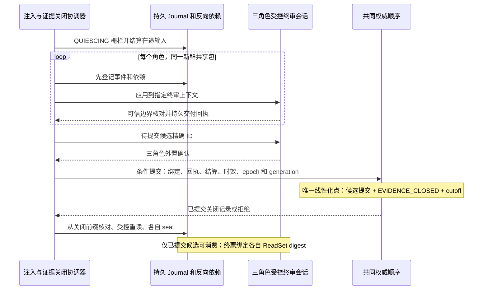
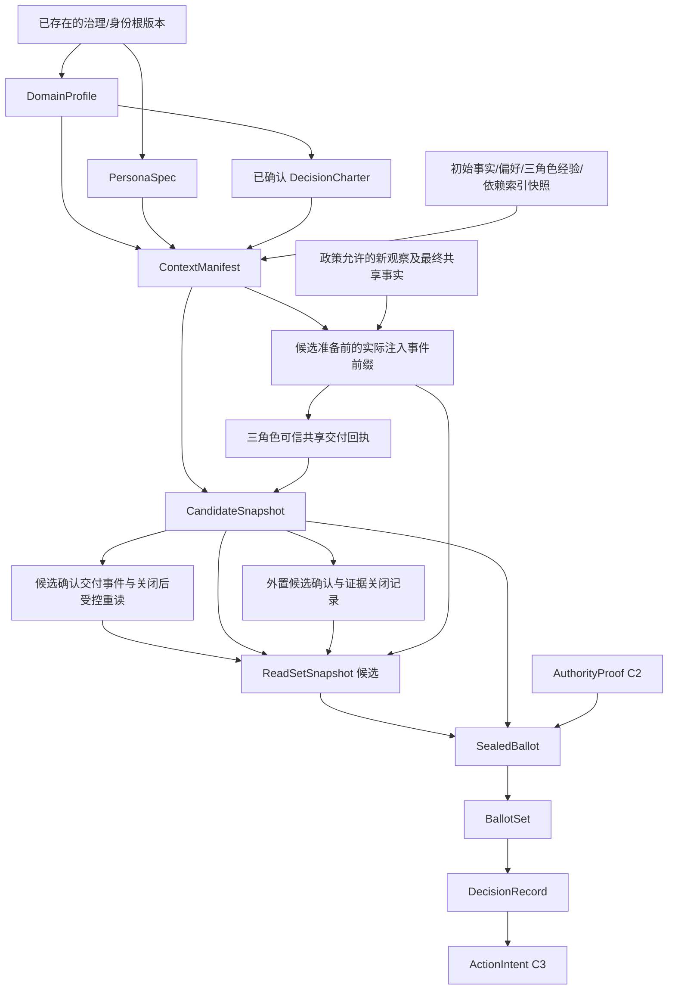

# C1-A：输入工件跨模块契约 v1.0（审阅草案）

> CAS-9 / GitHub #3、#4、#5、#8。基线：`e35aac6755d17604591e31d568692103205435ea`。
> 权威顺序：Rev4 → 已批准的 C0 `magi-cj/1` → 已合并的决策协议契约 → 本草案。
> **本文是待审阅的冻结提案，不表示设计已获批准、运行时已实现或 CAS-9 已完成。**
> 不修改 Rev4、现有 FSM、编排、RAG、MySQL、授权或发送路径。C1-B、C1-C、C2 均未启动。

## 0. 状态、追溯与放行条件

本文提出三个输入工件的字段、结构 Schema、身份和语义验证条件；§10 的未决项必须在受影响实现前明确决议。
“必须”描述拟冻结的消费者义务，不意味着当前代码已执行这些检查。相较 Rev4 新增的实现选择单独标为 `D-*`，不能以合并文档代替权限授予或规范变更批准。

| 契约章节 | 权威来源 | 原始不变量 / 关系 |
| --- | --- | --- |
| §2 身份、发布 | Rev4 §2、§3、§8；C0 §3–5 | GOV-01..03、EVID-02；身份细化 |
| §3 DomainProfile | Rev4 §2、§4、§18 | SELECT-01..03、AGENDA-01、STAT-01..03、OPS-01 |
| §4 PersonaSpec | Rev4 §5、§7、§17、§18.4–5 | PER-01..03、MEM-04、GOV-01 |
| §5–6 Context / ReadSet | Rev4 §6.1–6.3、§8、§18.3–4、§18.11 | MEM-01..04、EVID-01..02 |
| §7 失效与最终检查 | Rev4 §6、§12–14；决策协议 §4、§6 | AUTH-01..02、MEM-02..03、VOTE-06、VOTE-11..12 |
| §8 绑定及迁移 | 决策协议 §2–7；C0 §2 | ID-01..03、LEGACY-01..04 |
| §9 验收 | Rev4 §17–19 | 文档/结构/语义/行为/故障证据分别报告 |

准入：三工件字段和不变量经独立审阅、无未解决 P0/P1；D-01..04 有明确处置；C1-B 可实现已批准的 Domain/Persona 部分，C1-C 还需 ReadSet 身份、动态准入与共享终审边界决议。本文的自审不充当独立审阅。

### 0.1 当前状态核对（2026-10-22，Asia/Shanghai）

- `git fetch origin` 与 `git ls-remote`：远端 main 与上述基线一致；PR #33 已于 2026-10-19 合并。
- GitHub API：C1-A 初次启动时开放 PR 为 0；#3/#4/#5/#8 为 OPEN；#10/#11 为 CLOSED，不重开。本轮设计收敛复核 PR #34：Draft / OPEN / MERGEABLE，Base 为上述基线，修订前 Head 为 `861458fe4ef2a54d4f9b0ac8c07b9b9e2eeeb794`，正式 Reviews 为 0，该 Head 的 6/6 CI 已成功。这些 CI 不验收本轮新增的协议义务。
- #2 是组织入口；其 #10/#11 复选框未同步关闭事实，不以复选框推翻 Issue 状态。#13 仍 OPEN，不能从“没有开放 PR”推断没有其他在制工作；WIP 状态仍须核对。
- Linear：用户在本轮独立审阅中通过连接器确认 CAS-9 为 `In Progress`、CAS-10 为 `Backlog`。作者未取得认证读取，不将用户的复核写成作者独立验证；本草案不更新 Linear 或 Issues。

## 1. 源码调查与兼容边界

以下结论来自基线源码检查，不是新协议的运行验证。路径相对仓库根。

| 已有设施与真实调用链 | 可复用内容 | 缺失与边界 |
| --- | --- | --- |
| `backend/domain/canonical/canonical.go` | `CanonicalizeWithLimits`、`CanonicalizeStructWithLimits`、`Adopt`、`Canonical.Digest/ArtifactID`；三种输入类型已经在白名单 | 不检查领域 Schema、签发资格、撤销；白名单没有 ReadSetSnapshot |
| `backend/domain/validation/{validator,typed,schema_gen}.go` | `NewJSONSchemaValidator` 使用现有 jsonschema/v6；`SchemaGenerator` 及结构校验结果 | `TypedValidator` 会剥离 Markdown fence，不能作为权威入口第一步；Sonic 解析不能替代 C0 重复字段/数值检查；反射 Schema 不能自动提供跨字段规则 |
| `backend/domain/entity/role.go` → 运行时 RolePolicy | 已有三角色及结构化 assessment | 有浮点评分、技术/风险/机会阈值；Casper 的机会策略不等价于 Rev4 的目标、同意、控制/退出和负担。不得直接改名为 PersonaSpec |
| `backend/domain/entity/evidence.go` | 观察与解释分离；EvidenceRecord 携带代次和工具来源 | ReliabilityScore 是浮点启发分，不能转成 VERIFIED，缺少四类断言的资格/期限/派生验证 |
| `backend/domain/entity/memory.go`、`domain/memory/{projection,render}.go` | CaseMemoryProjection、证据/断言 ID、检索文本与展示截断字段分离 | 不是治理经验；无不可变经验快照或完整来源 DAG，摘要/投票置信分不能补成权限或人格合格证明 |
| `domain/orchestration/dispatcher.go:buildBase` → `domain/memory/context_builder.go:Build` → `KnowledgePort.Retrieve` | 现有共享上下文、RAG、DebateContext / PreviousRun 入口；检索失败可观测 | 当前按查询获得文本与 SourceURI；没有固定角色视图、读取日志、完整依赖证明。现有降级行为不能继承为新权威模式的允许规则 |
| `application/memory/{service,update}.go` | 搜索 owner 过滤；更新/删除后刷新索引，失败尝试恢复投影 | 编辑现有投影，不是追加经验版本；删除索引不等于撤销已暴露会话/摘要/在途票据，恢复也无撤销序列绑定 |
| `domain/runtime/agent_loop.go:CheckpointManifest` → `domain/execution/manifest.go:FreezeManifest`；恢复调用 `ValidateManifest` | 固定模型/工具/提示/配置身份；恢复先核对 manifest | 只冻结执行环境。`AgentSnapshotV2` / checkpoint 不是 ContextManifest；其既有摘要保留 `legacy-manifest/v1` |
| `application/decision/{service,run_manager}.go`、`domain/execution/`、owned artifact ports | 当前 ExecutionGeneration、持久 claim/lease、按代次读写及终态提交边界 | 运行所有权不是决策轮次或签发权限；不得借本 PR 改写已存在的终态事务或历史 Resolution |

复用策略：新类型置于后续领域包，Schema/语义验证消费 C0 的同一份 canonical bytes；调用现有验证器，不新建 JSON Schema 引擎。新旧协议按显式模式隔离，不能在新版验证失败后回退旧版放行。

## 2. 通用 Schema、身份与权威发布

### 2.1 结构 Schema 的读取规则

机器文件：[`contracts/input-artifacts/schema.json`](contracts/input-artifacts/schema.json)，JSON Schema 2020-12，根 `oneOf` 为三类**工件正文**。每个对象 `additionalProperties=false`，嵌套对象同样关闭；`$defs` 是正式字段/类型清单。外部 Schema 网络引用为零，`ExternalRef` 是数据引用，不能由 Schema 编译器下载。

- 除 `RiskPredicate.expected` 外，Schema 列出的属性**全部必填**，不允许隐式默认。
- `expected`：`EQ/LE/GE` 必须存在；`KNOWN/UNKNOWN` 必须不存在。`EQ` 可用标量/布尔/量纲值，`LE/GE` 只接受量纲值；C1-B 实现语义检查。
- **只有** `validity.valid_until` 与 `budget.cost_limit` 可为 `null`。前者表示无预设到期，但仍受撤销/依赖约束；后者表示无货币上限，仍须计费报告且 token/调用硬上限存在，不能把缺失字段解释为不限额。
- 必填数组允许为空仅以 `minItems=0` 为准；`[]` 表示显式无该项。`null`、缺失、空字符串都不能替代空数组。显式零纪元是合法数值，不是缺省值。
- Schema 不自动插入 WAIT、R3、零预算或当前版本；实例签发前必须显式写出。未知类型、Schema 版本、枚举和字段一律拒绝。
- `schema_version=1.0` 固定正文形状；`version` 为人类发布版本；`spec_version=1.0` 固定本次人格行为基线。消费者同时检查版本和内容身份，不接受 `latest` 或可变别名。
- Schema 检查结构；本节和 §3–8 的语义条件同等必需。格式匹配、JSON Schema `format` 和模型文本都不能单独证明时间、资格、风险或人格有效。

共同正文 `BodyHeader`：

| 字段 | 类型 / 含义 |
| --- | --- |
| `artifact_type` | 三种常量之一：`domain_profile` / `persona_spec` / `context_manifest`；必须与调用 C0 时的类型参数相同 |
| `schema_version` | 常量 `1.0`；未知版本拒绝 |
| `version` | `Version`，如 `1.0` 或 `1.0.1`；不是机器寻址依据 |
| `created_by` | `SubjectRef`：`subject_id, identity_source_id, identity_source_version`；可核验主体，不能信任模型自填姓名 |
| `issuance_policy_ref` | `ExternalRef`，指向**已经受信任**的发布资格规则版本 |
| `frozen_at` | UTC 毫秒时间：正文封存时点，不等于批准时点 |
| `validity` | `{not_before, valid_until}`；半开区间 `[not_before, valid_until)`，`null` 只表示无预设上界 |

`ExternalRef={namespace, object_id, version, digest_alg:"sha256", content_digest}`。用于外部身份源、资格政策、规则/统计计划和原始快照：按源协议保留原始字节并验证 raw-byte SHA-256；**这不是新工件的 C0 ID 或权威证明**。namespace 的受信任解析器须同时验证类型、对象 ID、版本、内容摘要和发布资格，拒绝可变引用。原始文本不经 NFC 重写。缺少解析器/完整原件/资格/依赖时为 `UNVERIFIABLE_REFERENCE`，禁止正式发布。

### 2.2 无自引用的摘要与包装

```text
CanonicalBody = C0.CanonicalizeWithLimits(body_bytes, artifact_limits)
SchemaAndSemanticValidate(CanonicalBody.Bytes, expected_type, trust_state)
digest = CanonicalBody.Digest(expected_type)
id = CanonicalBody.ArtifactID(expected_type)
Envelope = {artifact_id:id, digest, canonical_profile:"magi-cj/1",
            digest_alg:"sha256", body:CanonicalBody}
```

Envelope 是存储/传输包装，不作为另一个工件再哈希。其属性也采用白名单，全部必填；四个元数据字段不 nullable、无默认，`body` 为上述三类之一并遵守正文自己的 nullable 规则。编码 Envelope 不得将 `body` 内容作为字符串再转义后冒充原 canonical bytes。

| 正文类型 | C0 类型 | 精确前缀 | 消费者领域别名（包装字段，**不在正文**） |
| --- | --- | --- | --- |
| DomainProfile | `domain_profile` | `dprf_` | `domain_profile_id` / `domain_profile_digest` |
| PersonaSpec | `persona_spec` | `pspc_` | `persona_spec_id` / `persona_spec_digest` |
| ContextManifest | `context_manifest` | `ctxm_` | `context_manifest_id` / `context_manifest_digest` |

C0 原算法不变：`SHA256(UTF8("magi:canonical:v1:" + artifact_type + "\n") || canonical_bytes)`，小写 64 位 hex；前缀加完整摘要。**只有自己的派生 ID/digest/profile/algorithm 在包装外；对子工件的引用和所有其他权威字段全部入摘要**，包括类型、Schema/发布版本、发布者、政策引用、期限和 epoch。不得通用地剔除所有名字以 `_digest` 结尾的字段。

正文不包含自己的 ID、批准证明、状态、消费者 ID、子级票据 ID 或后继版本 ID。先固定正文 → 派生身份 → 取得绑定该精确身份的外部批准记录 → 权威发布，避免 `Profile → Proof → Profile` 循环。发布批准不回填正文。

存储回读先限制原始字节长度，再以本工件 Limits 预检；必须 `Adopt` 同一正文 canonical bytes，校验预期类型/Schema/领域条件，再算 Digest/ID 并逐项核对包装及请求的预期 ID。`Adopt` 当前只提供 C0 默认 Limits；不可因它的默认上限较宽而跳过工件上限预检。权威入口不剥 fence、不补字段、不归一化时间，不接受反序列化再重编码掩盖原始存储不规范。

### 2.3 精确数值、集合与字段级时间

- 所有整数为 C0 安全整数。Go `int64` epoch/round/generation 对外也不得超出 `2^53-1`；不接受浮点或指数写法。
- `Quantity={value:uint, unit, scale:0..9}`，物理值 `value / 10^scale`。`ratio` 范围 `[0,1]`；`percentage_point` 范围 `[0,100]`，二者不可混用。时间用 `millisecond` 且 `scale=0`；token/tool_call/byte/count 同样只能 `scale=0`。对字段及比较操作校验期望量纲，不得泛用“乘百万”。
- `Rational={numerator:uint, denominator:positive_uint}` 为**既约分数**，分母非零；alpha 等概率限制 `[0,1]`。例如 `0.020/3 = 1/150`，不能用截断 ppm 冒充精确 alpha。
- 数值转换/交叉相乘使用精确整数运算与溢出检查，必要时用任意精度中间值；不能因单个操作数在安全整数范围就假设乘积安全，也不能先转 float 再比较。
- `Money={minor_units:uint,currency:[A-Z]{3},minor_unit_exponent:0..9}`：数额 `minor_units / 10^minor_unit_exponent` 该币种单位；由冻结的计费映射确认币种及最小单位，不自行换汇。未知币种/计价源不得声明费用合规。
- `*_ms` 数字属性直接表示整数毫秒，不再加隐式单位；截止偏移以轮次活动时钟为原点，任务有效期与仲裁另按墙钟处理，暂停状态仅 WAITING_INPUT/ARBITRATION。
- `frozen_at`、`validity.not_before/valid_until` 及 §6 的 `injected_at`、外部批准/撤销事件时间全部严格使用 `YYYY-MM-DDTHH:mm:ss.SSSZ`。需日历有效、秒 `00..59`；拒绝偏移、闰秒和截断/补精度。来自同一受信任时间源；有效期不得因转换延长。非 null 上界须 `not_before < valid_until`，`frozen_at` 不晚于权威发布；发布/消费分别校验当前时间在有效区间，依赖到期取最早上界。初始 Manifest 另须先于本轮初审。
- 按语义排序的数组：规则按 rule_id、证据规则按 rule_id、工具按 tool_id、SLA 按 metric_id、参数按 parameter_id、snapshot_refs 按 snapshot_id、allowed_context_ids 按 ID、domain_extensions 按 extension_id、各种 ID 集合按 ID。键必须唯一，**不能仅靠 `uniqueItems` 排除同 ID 不同内容**。同一规则的合取谓词按 attribute_id 排序，同一属性只出现一次；证据方法/来源/事件按稳定引用元组或字符串排序。
- 保持顺序的数组：`core_priority`、`evidence_priority`、`call_allocation`、规定输出字段；ReadSet 的 events 按序号。核心审查项/条件/触发器是集合，按代码排序。所有比较键为 NFC 字符串的 UTF-16 code unit 序；C0 不替生产者排序。
- `schema.json` 例子是结构样本，未规范化集合顺序；它们不声称是可发布工件。C1-B Golden 必须完成语义排序后生成。

### 2.4 发布、签发资格与状态

| 工件 | 产生者 | 资格确认 / 批准者 | 消费者 |
| --- | --- | --- | --- |
| DomainProfile | 领域配置编辑器（模型可提出草案） | 受信任治理登记中的领域治理者；按预先批准的资源/领域范围、所有者模式和门槛批准/撤销 | Charter、分类器、议程、证据验证、裁决、出口、验收 |
| PersonaSpec | 人格维护流程 | 受信任人格维护者确认正式基线；领域扩展还需领域治理批准。行为验证记录来自独立验收流程 | 上下文管理器、各角色、票据/裁决、经验校准 |
| ContextManifest | 上下文管理器 | 独立资格校验器核对已确认 Charter/领域/人格、数据访问资格及三视图完整性；不是模型自证 | 三角色、候选冻结、终票、裁决、动作、恢复 |

发布批准记录至少包含 `{target_type,target_id,target_digest,policy_ref,approver_subjects,authority_proof_id,confirmed_at,authority_epoch}`；由权威状态验证，**不嵌入目标正文**。这是 C2 的输入要求，不是本 PR 已冻结的 AuthorityProof Schema。

资格来自先于目标发布的受信任治理根/身份源，不能读取目标正文的 `created_by`、`issuance_policy_ref` 就授予资格。治理者列表变更也须旧有效治理规则确认；不能在自制 DomainProfile 中把自己设为治理者再批准它。签名正确仍需验证逐跳权限、冲突、范围、到期、撤销。权限源或时间源不可用即失败关闭；OWNER 模式未声明遵守 Rev4 的 OWNER_ALL，不临时多数。

状态在外部追加的权威登记中：`DRAFT → VALIDATED → APPROVED → PUBLISHED`，有效性叠加 `EXPIRED / REVOKED / DEPENDENCY_INVALIDATED`，不是修改正文状态。普通 `SUPERSEDED` 只改新任务的默认解析，旧版有效时可完成；安全撤销不允许恢复为有效。纠正/再批准产生新正文/身份/新轮，不能“取消撤销”复活旧票据。

D-03 尚未选定治理根实现、签名封装或跨服务确认存储。**三个工件均不能仅凭本 PR 的 Schema 在生产自签发布**。具体身份与撤销线性化协议由 C2 冻结；C1-B 可先实现离线结构/语义验证，不能伪装完成发布授权。

### 2.5 资源上限（D-04：拟定的工程上限，不是领域安全阈值）

| 对象 | MaxBytes | MaxDepth | MaxMembers | MaxStringBytes | 额外条目边界 |
| --- | ---: | ---: | ---: | ---: | --- |
| DomainProfile 正文 | 262144 | 24 | 4096 | 16384 | 规则/工具/证据/SLA/参数分别至多 64；每规则谓词至多 16 |
| PersonaSpec 正文 | 131072 | 24 | 4096 | 16384 | 扩展至多 16，每扩展最低调查至多 16 |
| ContextManifest 正文 | 262144 | 24 | 4096 | 16384 | 恰好三角色；每角色 allowed contexts 至多 128；snapshot_refs 至多 256 |
| ReadSetSnapshot 候选 | 1048576 | 24 | 32768 | 16384 | 每角色每轮至多 512 个注入事件；单事件父依赖至多 64，闭包节点至多 2048 |
| ReadSetJournal 候选 | 每事件 32768 | 16 | 512 | 8192 | 不超过上述每轮事件/字节累计上限；重试计预算 |

聚合字节/成员上限可能先于单字段上限触发，取最严格者。超限显式 `RESOURCE_LIMIT`，不能截断决定性材料/依赖后称完整。外部 blob 只保存引用，但抓取/验真也受任务输入预算及流式字节上限约束，不能借引用逃避预算。上限调整需 Schema/版本审阅；D-04 未批准前不能宣称这些数值来自 Rev4。

Schema 的 K_max 至多 64 是拟定的配置资源边界，不是支持 k>4 的实现/验证声明；Rev4 参考模型检查仍固定 k=1..4，其他领域/规模必须完成对应配置和验收。

### 2.6 通用资源政策与组合预算（D-04 收敛）

| 政策层 | 来源及约束 | 通用 Schema 的责任 |
| --- | --- | --- |
| 跨领域协议边界 | C0 安全整数、精确量纲、权限及撤销失败关闭；通用 R0–R3 门槛 | 固定数值形状及协议门槛，不用参考域数值代替通用规则 |
| 正式 PersonaSpec v1.0 | Rev4 §17.1–4：每角色最多 6 次主动调用、6000 输出 token；调查分配四桶 `[2,2,1,1]` | PersonaSpec 的 `tool_call_limit=6`、`output_token_limit=6000` 及正式调查分配保持不变，不能由领域配置扩大 |
| ROLLOUT-LAB-1.0 | Rev4 §18.5：全任务最多 24 次调用、24000 输出、200000 输入 token；幂等读取重试和每角色格式修复各最多 1 次 | 由选定参考域的语义验证器核对；通用 `Budget` / `Windows` 不硬编码这些实例值 |
| 暂定工程边界 | §2.5 正文大小、深度、成员、字符串、事件及依赖数；固定实现支持的容量 | 明确超限失败，不截断或隐式增加预算；数值不是 Rev4 的安全结论 |

因此通用 `Budget.role_tool_calls`、`role_output_tokens` 为正安全整数，`Windows.read_retries`、`format_repairs_per_role` 为非负安全整数，结构上允许 12/12000/2/2。选择 Persona v1.0 后每角色仍最多 6/6000；选择 ROLLOUT-LAB 后重试/修复仍最多 1。结构接受仅说明可以描述另一个配置，不构成该配置的运行许可、人格版本变更或验收通过。

组合执行预算取 DomainProfile、已确认 Charter、所选 PersonaSpec 与工程容量中**所有适用上限的最严格者**，角色限额与全任务限额同时满足；若无法满足最低调查则弃权/暂缓，不能扩大限额。重试、格式修复、共享验证、协调及报告按实际资源归属计入对应总预算，不能换入口避开计数。C1-B 须实现组合语义与实例检查；当前检查器只验证结构层分离。

### 2.7 信任根与顺序接口责任（D-03 收敛，非 AuthorityProof Schema）

治理根必须由独立部署/治理流程预先初始化和明确确认，具有不可变根版本、适用作用域与可核验主体。根初始化、轮换、应急撤销、凭据来源及失陷恢复归 C2/#5 冻结；不能从待批准 Profile、PersonaSpec、模型文本或它们自填的发布政策启动自身权限。缺少可信根只允许离线结构/语义验证，禁止权威发布。

| 责任方 | 输入与必须给出的结果 | 不能由其替代的责任 |
| --- | --- | --- |
| C1 离线验证器 | 正文、预期类型/版本/ID、固定引用及完整依赖；输出结构/领域约束结果与待验证资格依赖 | 不认证治理根、主体或签名；不以 Schema 合法签发发布批准或人格行为通过 |
| C2 信任/授权服务 | 已确认根版本、认证主体、精确目标/动作/资源范围、逐跳委托/同意、可信时间、当前 epoch；输出可核验批准/拒绝与权威序列位置 | 不从正文 `created_by` 推断资格；不把治理发布资格等同于任务执行权 |
| C1-C 注入及证据关闭协调器 | 固定 Manifest、角色会话、持久 Journal/反向边、可信交付回执；提交唯一候选/关闭记录并提供完整性核对 | 不自行生成批准者资格或承诺跨服务线性化；必须使用 C2/C3 冻结的顺序接口 |
| C3/#6 出口与权威状态实现 | 精确待执行意图、依赖闭包、预期 context/authority/credential epoch 与 execution generation；在共同权威顺序中校验并提交受保护发送 | 不允许“先读有效、稍后独立发送”；最终检查与 SEND_COMMITTED 不能跨越未排序的撤销 |

提议的接口责任为 `VerifyAuthority(request) → verified_record / denial` 与 `CommitIfCurrent(expected_state, operation) → committed_record / conflict / unavailable`。请求须绑定根/政策版本、主体、精确目标及范围；验证记录须绑定输入摘要、资格链、有效期、各类 epoch 和权威序号。提交记录还须绑定操作幂等键、前置版本、结果及提交序号/UTC 毫秒时间。记录以 ExternalRef 固定原件，不能仅相信调用者提交的 `verified=true`。这些是后续接口的必备信息，不是新增可自行签发的权威类型；具体字段、认证封装和分布式存储协议留给 C2/C3 审阅。

候选关闭、撤销、seal、票据接收、裁决发布和 SEND_COMMITTED 必须获得可比较的权威顺序；是否使用一个日志或有证明的跨服务排序由 C2/C3 决议。context epoch、authority epoch、credential epoch、execution generation 分别核对，不合并为一个整数。权威来源不可用、顺序不可判定、资格/依赖不完整均失败关闭。普通发布不提升安全撤销 epoch；本版同 context scope 任一 epoch 不匹配即新轮，不暗含“未受影响”豁免。

## 3. DomainProfile

### 3.1 完整字段分组

除 BodyHeader，全部字段必填；嵌套精确字段以 Schema `$defs` 为准。

| 字段 | 类型 / 机器义务 |
| --- | --- |
| `domain_key` | 稳定领域名，例如 ROLLOUT-LAB；与 `version` 构成人类发布键 |
| `governance_policy_ref` | 已存在治理规则/治理者资格版本；须与 issuance policy 和信任根相容 |
| `risk_policy` | `rules_version,required_attributes,rules,aggregation,unknown_level,downgrade,r3_execution` |
| `evidence_rules` | 四类断言各至少一个规则；每条有来源、方法版本、验证者资格、TTL、失效事件；关键断言独立复核 |
| `tool_scope` | 每工具 ID/版本/定义摘要、READ/WRITE、资源集合、风险范围、适配器能力；空集合明确禁止工具 |
| `selection` | K_max、默认/允许策略、Rev4 MATERIAL_PENDING 判据、固定票数、仅 R1 试行 |
| `budget` | 角色/任务工具调用、角色/任务输出、任务输入硬上限、显式货币上限或 null |
| `windows` | 提交/异议/修订/冻结/活动决策、仲裁接案/最终、任务期、单次读取时间、重试/格式修复次数、暂停状态 |
| `sla_targets` | 每项 metric_id、预登记总体引用、LE/GE/EQ、精确量纲界限、测量方法引用 |
| `statistics` | 完整冻结统计计划引用、声明数、总 alpha、标签/分母/独立性/模型检查边界引用 |
| `experience_policy_ref` | 发布批准、冲突分区、校准触发/连续性界限、回滚规则；不借领域配置允许改核心价值 |
| `retention` | 完整输入、最小完整性元数据、缓存保留及备份删除毫秒上限 |
| `adapter_policy_ref` | 各写能力模式、恢复/结果查询、隔离和见证能力的完整规则版本 |
| `instance_parameters` | 命名、精确量纲的领域阈值；仅能被已登记的规则/测量方法引用，不能成为自由模型解释的授权 |

外部政策不是省略的必填配置：发布验证必须实际解引用并采用对应版本的机器验证器，未知方法/参数代码拒绝。统计 plan 至少含声明逐项 alpha/分母/阈值/区间方法、数据与标签来源、独立性假设、等预算比较、失败和不可判定处理；缺一项不能发布。它是先冻结的计划数据，不引用未来 AcceptanceManifest ID；AcceptanceManifest 后向绑定本 Profile 和这些计划，避免循环。

### 3.2 风险分类与降级

通用门槛来自 Rev4 §4，不由领域配置覆盖：

| 等级 | 固定语义 | 票数与执行边界 |
| --- | --- | --- |
| R0 | 只读/建议，无受保护副作用 | 至少 2 赞成；仍需读取权限 |
| R1 | 边界明确、恢复已验证、影响/资源在预授权额度内 | 至少 2 赞成；精确预授权或逐次授权 |
| R2 | 超过 R1，范围明确且可恢复 | 3 赞成；指定人类逐次授权 |
| R3 | 不可逆、无界、关键属性未知或越域 | 3 赞成仅形成正向建议；领域启用的独立特许及必需主体同意，否则不执行 |

规则 `all_of` 仅允许已登记的属性。`KNOWN/UNKNOWN` 检查证据状态而非模型是否给出字符串；`EQ/LE/GE` 校验值类型、量纲、比较方法版本。每个规则列出 required evidence rule IDs。完整输入先经过四类证据验证；输出固定 `MAX_APPLICABLE`，取所有通用及领域适用规则最高等级，不允许“首条命中”。关键属性未知/越域直接 R3；无规则可解释不能回退 R0。

分类结果作为 CandidateSnapshot 的版本绑定支撑记录，至少携带：`candidate_id,domain_profile_id,rules_version,input_attribute_values,input_evidence_refs,matched_rule_ids,risk_level,classified_at,valid_until`。记录由独立规则引擎产生，属性证据、输入摘要和规则引用进入候选/票据的依赖闭包。C1-A 不添加新的顶层权威类型；C1-B/候选切片须决定其嵌入位置，不能信任孤立的 `risk_level` 字符串。

同一轮发现更高风险/关键证据失效，立即停止旧门槛放行并按上下文规则失效，开启新轮。降低等级必须有独立验证的新证据与新轮；即使治理者批准宽松新规则，也不得在旧轮重算降级。新 Profile 发布资格依旧治理规则/不可覆盖门槛检查；撤销指定精确 ID/版本并传播，不能仅撤销可变别名。

### 3.3 通用值与 ROLLOUT-LAB-1.0 的分离

Schema 约束数值形状和通用门槛；下表是 Rev4 §18 的**参考实例约束**，不得写成所有领域的缺省参数。结构示例引用合成政策/证据，不是完整、批准的 ROLLOUT-LAB Profile。

| 参数组 | ROLLOUT-LAB-1.0 必须绑定的值 / 含义 |
| --- | --- |
| 候选及风险 | K_max=4；C0/C1 R0；C2 满足全部门槛时 R1；C3 R2 且每次人工确认；R3 禁外部执行 |
| C2/C3 暴露 | 5% / 10% = `{value:5/10,unit:ratio,scale:2}`；最长 900000 ms；错误增加 0.5 **百分点** = `{5,percentage_point,1}`；恢复 60000 ms |
| 目标 | P95 延迟相对改善至少 10% = `{10,ratio,2}`；不把未达目标自动变成执行义务 |
| 选择 | 默认 WAIT；REVERSIBLE_TRIAL 仅 C2 且不关闭替代路径；C3 WAIT 或有权 HUMAN_WAIVER |
| 证据寿命 | 遥测 120000 ms；相同版本/依赖恢复证据 86400000 ms；预测 3600000 ms；偏好最长 86400000 ms；写权限最长 300000 ms；条件变化取更早失效 |
| 新鲜终审 | 候选冻结前 30000 ms 内取三者相同的新鲜共享状态；冻结后决定性变化新轮；等待不能延长证据期限 |
| 经验 | 每角色独立批准视图；自动发布关闭；监测最近 200 有结果任务，至少 100 才估软指标；硬失败立即隔离 |
| 校准触发 | 成功点估计 < 95%；相同条件纠错失败 5 次；单一来源 > 80%；兼容配对退化容忍 0.01；均不替代置信界和原行为门槛 |
| 预算 | 每角色最多 6 次/6000 输出 token；全任务 24 次/24000 输出/200000 输入 token，含共享验证/协调/报告 |
| 活动窗口 | 60000 / 120000 / 150000 / 180000 ms；活动决策 300000 ms；一次交叉质询/终票；格式修复 1 次；读取 10000 ms、幂等重试最多 1 次 |
| 仲裁/任务 | 接案 3600000 ms，裁定及非评测任务有效期 86400000 ms，从更早任务到期；评测不借等待逃避超时 |
| 出口能力 | 仅 FENCED_IDEMPOTENT 可写；意图回执 30000 ms；凭据撤销目标 1000 ms；结果见证 5000 ms；核对开始 10000 ms、结果或明确未知 60000 ms |
| 见证 / 数据 | 3 持久副本至少 2 确认；至多 1 永久副本丢失边界；权威/已确认审计 RPO=0；模型抽象不代替真实副本故障测试 |
| 运行目标 | 20 活动任务；决策 P95 <=240000 ms；完整协议 300000 ms 内 >=99%；执行另限 990000 ms；不可判定 <=2%；适格自动覆盖 >=90% |
| 统计计划 | 4800 独立重置回合、24 场景族；三基线配对、主效用 delta=3/100；LCB 方法 Rev4 §18.9；人格每指标 1200 基础任务×3 种子（重复不充独立样本） |
| 声明族 | 15 人格 alpha 各 1/1000；3 效用各 1/150；2 风险各 1/200（零事件且上界 <=1/500）；3 运行各 1/600；合计 23、总 alpha=1/20 |
| 保留 | 输入/票据/ReadSet/结果 90 天；完整性元数据 365 天；缓存 1 天；备份 7 天内不可再恢复删除，期间不能回到可读视图 |

模型/适配器/工具组合变更不能无限继承该域验收报告；支持新领域也不能直接继承参考域的统计或安全结论。

## 4. PersonaSpec

### 4.1 完整字段与行为边界

除 BodyHeader，必填：`persona_id, spec_version, baseline_id, maintenance_policy_ref, core_priority, mandatory_reviews, minimum_investigation, evidence_priority, required_output_fields, investigation_output_fields, tool_call_limit, output_token_limit, call_allocation, transfer_policy, support_conditions, reject_conditions, abstain_conditions, correction_triggers, domain_extensions, compatibility`。

- 三种 persona_id 固定 `melchior / balthasar / casper`；分别对应 `MELCHIOR-1.0 / BALTHASAR-1.0 / CASPER-1.0`，不能仅改显示名冒充同一人格。
- `core_priority` 是**获准裁量内**的有序关注，不是效用权重或执行许可；共同服从 Rev4 §3.1。`mandatory_reviews`、支持/反对/弃权/纠错代码逐项映射 §17，不能用任意非空字符串代替正式语义。
- `minimum_investigation` 每项 `{requirement_id,description,acceptable_evidence_rule_ids,substitution}`。引用规则必须存在于本轮 DomainProfile，类型相符；合格独立已有记录替代调用须证明适用性并登记 read-set，不能当作零读取。
- `required_output_fields` 与 `investigation_output_fields` 的完整固定列表在 Schema 内。产物含有字段不证明内容真实或调查完成；不要求暴露内部思维过程。
- v1.0 每角色工具 6、输出 6000；`call_allocation` 四桶 `[2,2,1,1]`。与 Domain/Charter 总/角色预算取最严格者。最低调查未完成不得转移未用额度；完成后转移记录原因。共享验证/缓存/重试也登记并计入相应总预算。预算不必花完，不足不能伪造完成。
- `domain_extensions` 只能添加审查项/最低调查，不替换或删除核心；其 domain_profile_id 必须是当前精确版本，extension 的 approval_policy_ref 不自行授予维护权。预算冲突时真实弃权/暂缓，不能略过新增要求。
- `compatibility={core_change:"INCOMPATIBLE",continuity_policy_ref,behavior_acceptance_ref}`；普通兼容发布需要硬不变量、原人格行为门槛、配对连续性界限和无未解释价值顺序变化的独立证据。结构校验不能签发这些证据。

### 4.2 v1.0 正式基线代码映射

下列大写代码是本文为 Rev4 原文提出的机器词汇，**不是额外价值规范**。列表按语义顺序展示；集合在发布时按 §2.3 排序。描述不得被自由字符串改写为较弱条件。

| 角色 | core_priority（依序） | mandatory_reviews |
| --- | --- | --- |
| melchior | TARGET_EFFECT → RESOURCE_OPPORTUNITY_COST → IMPLEMENTATION_CONVENIENCE | BASELINE、EFFECT_SIZE、SCOPE、RESOURCE_TIME_COST、KEY_ASSUMPTIONS、ALTERNATIVES、NO_ACTION |
| balthasar | IRREVERSIBLE_SPILLOVER → RECOVERY_RESPONSIBILITY → LONG_TERM_RESILIENCE | AFFECTED_SUBJECTS、FAILURE_MODES、MAX_LOSS、IMPACT_SCOPE、RECOVERY_EVIDENCE、RESPONSIBILITY、STOP_CONDITIONS、NO_ACTION_RISK |
| casper | EXPLICIT_GOAL_CONSENT → CONTROL_EXIT → BURDEN_ADOPTION | EXPLICIT_GOAL、MARKED_INFERENCE、REQUIRED_CONSENT、CONTROL_CHANGE、EXIT、BURDEN_TRANSFER、REAL_GOAL_ADOPTION |

| 角色 | 最低调查（各至少 1 条合格核验） | evidence_priority（依序） | 调用桶（2 / 2 / 1 / 1） |
| --- | --- | --- | --- |
| melchior | EFFECT_BASELINE：目标效果/基线；FEASIBILITY_COUNTEREVIDENCE：关键可行性或反证。允许适用的独立记录替代重复调用 | REPRODUCIBLE_TASK_MEASUREMENT → VERIFIED_RESOURCE_RECORD → APPLICABLE_EXPERIENCE → MARKED_MODEL_SPECULATION | EFFECT_BASELINE / COUNTEREVIDENCE_FEASIBILITY / CANDIDATE_COMPARISON / CORRECTION_RESERVE |
| balthasar | FAILURE_IMPACT：失败/影响范围；RECOVERY_VERIFICATION：恢复能力，不能仅引用“可回滚”计划 | SAME_ENVIRONMENT_RECOVERY_MEASUREMENT → RESOURCE_AUTHORITY_BOUNDARY → COMPARABLE_FAILURE_HISTORY → UNVERIFIED_RECOVERY_PROMISE | FAILURE_IMPACT / RECOVERY_VERIFICATION / NO_ACTION_RESPONSIBILITY / CORRECTION_RESERVE |
| casper | AUTHENTICATED_GOAL_PREFERENCE：有效目标/偏好原始确认；CONTROL_CONSENT_BURDEN：控制/同意/负担的合格记录 | AUTHENTICATED_SUBJECT_RECORD → APPLICABLE_CONSENT_AUTHORITY_CHAIN → VERIFIABLE_OPERATIONAL_BURDEN → INFERRED_PREFERENCE_NO_AUTHORITY | GOAL_PREFERENCE / CONTROL_CONSENT / BURDEN_ALTERNATIVE / CORRECTION_RESERVE |

共同底线：经核验任务原始证据优于未经核验材料；反证不因优先级被排除；模型推测单列。已确认宪章取舍优先，不能用“我是风险人格”拒绝修正、用“用户似乎愿意”生成同意、用效果高抵消硬约束。

| 角色 | support_conditions | reject_conditions | abstain_conditions | correction_triggers |
| --- | --- | --- | --- | --- |
| melchior | EFFECT_SUPPORTED、FEASIBILITY_RESOLVED、CHARTER_SATISFIED | EFFECT_REFUTED、CHARTER_COST_EXCEEDED、UNACCEPTABLE_DEFECT | EFFECT_UNVERIFIABLE、FEASIBILITY_UNVERIFIABLE、EVIDENCE_CONFLICT | BASELINE_ERROR、MEASUREMENT_INVALID、KEY_COST_CHANGED、COUNTEREXAMPLE、CONFIRMED_GOAL_REVISED |
| balthasar | RISK_ACCEPTED_WITHIN_BOUNDARY、DECISIVE_RECOVERY_SATISFIED、RESPONSIBILITY_CLEAR | UNACCEPTABLE_HARM、RECOVERY_UNAVAILABLE、CHARTER_RISK_EXCEEDED | CONSEQUENCE_UNKNOWN、RECOVERY_UNKNOWN、BOUNDARY_UNCLEAR、DECISIVE_CONFLICT | RECOVERY_VERDICT_CHANGED、IMPACT_CHANGED、RESPONSIBILITY_CONFIRMED、NEW_COUNTEREVIDENCE、NO_ACTION_RISK_CHANGED |
| casper | CONFIRMED_GOAL_CONTROL_BURDEN、REQUIRED_CONSENT_COMPLETE | EXPLICIT_GOAL_CONFLICT、UNAUTHORIZED_CONTROL_LOSS、REJECTED_BURDEN | KEY_PREFERENCE_UNKNOWN、CONSENT_UNKNOWN、EXIT_UNKNOWN、PREFERENCE_CONFLICT | PREFERENCE_CONFIRMED_WITHDRAWN、AUTHORITY_CHANGED、BURDEN_EVIDENCE_CHANGED、INFERENCE_MISLABELED |

支持条件是合取的最低义务；反对/弃权/纠错集合按任一适用条件触发，不能因未列具体自然语言变体忽略同义风险。缺证据有效不等于证据证明无效。纠错只更新受影响比较，不编造其余价值/事实变化。

### 4.3 版本与可证明性

`(persona_id,spec_version)` 标识正式核心基线；`version` 可以标识兼容的附加审查发布，但内容变化仍产生新 pspc ID。核心价值/合法性边界变化需要新的不兼容 spec_version、基线登记及契约审阅；本 v1 Schema 拒绝未知 spec_version，不能拿 `version` 补丁号覆盖核心变更。相同 ID 内容变更由 C0 拒绝；相同基线名内容变更由 Persona 语义验证拒绝。

机器可以检查：字段完整、代码/顺序匹配、最低调查引用存在、预算分配、输出清单、版本、扩展批准。以后可检查可观测调查记录是否齐备。**机器 Schema 不能证明**调查真实执行、证据独立、价值忠实、复合干预纠错或效用提升；这些归 Rev4 §17.5 / §18 的独立行为实验。模型自评、生成者自签、同票或不同票都不是人格合格证明。

新任务使用已批准的新版本；已开始任务继续有效旧版本。紧急安全回滚/撤销旧版需按 §7 重建所有受影响会话、经验与摘要，不能仅换 system prompt。任务模型无修改/签发/撤销 PersonaSpec 权限。

## 5. ContextManifest：冻结允许视图

### 5.1 完整字段

| 字段（全部必填） | 约束 |
| --- | --- |
| BodyHeader | §2；创建者必须为合格上下文管理器 |
| `case_id`, `round` | 轮次 >=1；不以 execution_generation 代替 round |
| `charter_id` | C0 `chtr_` 精确 ID；已经主体确认且有效 |
| `domain_profile_id` | C0 `dprf_` 精确 ID；与 Charter 选用版本一致，不能选最新 |
| `shared_fact_snapshot_id` | 不可变初始共享事实包；含完整四类断言记录/依赖/范围，不是只含摘要字符串 |
| `user_preference_snapshot_id` | 已认证的偏好快照；空偏好需显式空快照及“不足时请求确认”语义 |
| `roles` | 恰好三个固定键，各 `{persona_spec_id,experience_snapshot_id,allowed_context_ids}`；本人经验可不同，其他角色不可隐式继承 |
| `snapshot_refs` | 为以上所有快照、allowed contexts 及依赖索引提供唯一 descriptor，不能存在未声明/不必要条目 |
| `source_dependency_index_version` | 对应唯一 `DEPENDENCY_INDEX` descriptor 的 snapshot_id；名字含 version 但值是精确不可变版本标识，不能“当前索引” |
| `context_revocation_epoch` | 当前作用域撤销代次的安全整数；不与权限 epoch 或运行 generation 混用 |
| `context_revocation_scope_id` | 预先登记的上下文撤销作用域；必须与 epoch 一起比较，不允许跨领域/租户比较裸数字 |
| `admission_policy_ref` | D-02 候选：固定读取源、查询/权限边界、动态材料准入及共享终审规则的机器政策版本 |

`SnapshotRef={snapshot_id,kind,version,content_digest,source_ref,qualification_policy_ref,validity}`：快照是已冻结的外部字节包，由 Manifest 的 canonical 正文绑定；不是擅自发明的第四种 C0 工件。解析器校验 kind、版本、原始字节摘要和数据访问资格。任务工件中别名到快照 ID 必须唯一、不可变；同一个 snapshot_id 不可跨 kind 或版本复用。`snapshot_refs` 要覆盖恰好所需 ID，重复 ID 即使内容不同也拒绝。

共有事实、偏好、三份经验及所有 allowed context 在初审前完成资格检查和不可变封存；三角色 PersonaSpec 的 persona_id 必须与其 roles 键一致。三个角色的 shared facts/偏好映射相同，经验与 allowed_contexts 独立固定。允许视图是访问上限，不能作为“已实际读取”的证明。无经验也需有受控、可验证的空经验快照，不能填空串或指向最新记忆。

`allowed_context_ids` 表示固定的上下文视图/数据访问边界，不是允许加载任意“最新内容”的别名。D-02 的新观察必须证明其源和访问范围落在初始视图及固定 admission policy 共同允许的范围内；政策不能扩大数据访问权或切换经验/偏好快照。不得以新增材料描述符绕过原来的角色隔离。

### 5.2 初始视图、动态观察与终审冻结（D-02，收敛为方案 A，待复核）

Rev4 §6.1 的不可变初审清单与 §18.3 的终审新鲜遥测需要同时成立。本轮选定的设计草案方案 A：Manifest 固定**初始事实/偏好/经验版本与读取准入政策**；初审后通过政策准入的检索/工具结果逐条冻结为材料描述符并追加 Journal。它们是有来源的新观察，不是替换初始 shared_fact_snapshot_id。人格/经验/偏好版本不通过该渠道热替换。

终审前创建共同的 `final_shared_inputs` 外部不可变包：三者收到同一 ID/版本/摘要的新鲜事实及其验证结论，分别登记实际注入；独立检查与初审差异，不以新材料抹掉旧判断的历史。包在 CandidateSnapshot 冻结前产生并符合参考域 30 秒新鲜性；在途授权、偏好、关键经验被撤销仍立即走失效，不能以“普通新观察”掩盖安全事件。

CandidateSnapshot 冻结与权威 `EVIDENCE_CLOSED` 事件同一顺序边界；三份可信交付回执、实际读取记录、无未结算注入及三角色候选确认必须先齐备，提交协议见 §6.5。仅将 final_shared_inputs ID 写入候选或 ReadSetSnapshot 不满足前置条件。此边界之后只允许重读已准入版本的材料；任何新增的判断相关材料或决定性事实变化都开新轮。后续在线授权/停止阈值检查只用于原动作保护，不为旧票添加新理由。终票 ReadSetSnapshot 含相同的 `final_shared_inputs` 及 cutoff sequence，验证三个角色的共享输入相同，但各自实际经验读取可以不同。

**这是待验证的细化方案，不是对 Rev4 已存在机制的描述。** 如果审阅认定 §6.1 要求所有未来材料 ID 在初审时已穷尽枚举，则不能采用政策准入；须选择预收集全部版本或新增轮次/阶段工件设计，并评估 §18.3 新鲜遥测与调查预算影响。不得用原地修改 Manifest 消解冲突。本轮设计采用方案 A 作为复核基线，但不把原则支持当作事务协议已获批准；§6.5 的唯一绑定/交付/提交规则及未来契约修订仍是实现准入条件。

## 6. 实际读取：候选 Journal → Snapshot 模型

### 6.1 方案比较与选择边界

| 方案 | 可变性、终票绑定 | 对 Rev4 的影响 |
| --- | --- | --- |
| A：不可变 Manifest + 追加 Journal + 终票前不可变 ReadSetSnapshot（本轮草案选定） | Manifest ID 固定；动态事实为受控准入；密封票绑定全量读取闭包 | 便于完整追溯及撤销；需要 D-01 身份、D-02 准入/终审、D-03 权威日志顺序决议 |
| B：每次读取重发 ContextManifest | 每次生成新 ctxm，票据只绑定最终者 | 初审 Manifest 与后续轮次唯一绑定发生分裂；除非新增明确前驱/轮次语义，否则不满足现有契约。不等于允许原地修改 |
| C：初审前穷尽全部输入，再整体冻结 | 无动态源，实际读取仍另作记录 | 最易保持 ID 边界，但无法一般性覆盖工具调查、交叉质询及临近冻结的新鲜遥测；可能需要多轮重建 |
| D：终票只声明若干已用 ID 或模型自报摘要 | 动态列表无完整记录，无法证明系统注入 | 拒绝：不满足实际 read-set、派生依赖及保守失效要求 |

方案 A 已作为本轮设计收敛方向，D-01 相应选定独立 `read_set_snapshot` / `rset_` 身份；不再将嵌入 SealedBallot 作为并列待选方案。C0-R 已独立注册该类型的内容身份；不能调用 `Digest("context_manifest")` 哈希 ReadSet 或裸 SHA-256 并称 C0 合规。注册与完整验证/读写迁移分开，按 §6.4 执行；PR #32 的决策契约不变。类型注册不等于正式发布或集成完成。

### 6.2 候选正式记录（语义 Schema；仅注册 C0 类型身份）

以下 `record{}` 是封闭记录；全部字段必填、不 nullable、无默认；数组类型/排序/上限按 §2.3/2.5。D-01 的 C0 类型身份已在 C0-R 注册；在 §6.4 的完整 Schema/语义实现、正文独立 Golden、消费者验证及能力协商完成前，仍不能签发生产 read_set_digest。

```text
ReadSetJournalKey = record{case_id:Token, round:PositiveSafeInt,
    context_manifest_id:ContextID, persona_id:Role}
ReadEvent = record{
    journal_key:ReadSetJournalKey, sequence:PositiveSafeInt,
    authority_sequence:PositiveSafeInt, execution_generation:PositiveSafeInt,
    delivery_id:Token, kind:enum{RETRIEVAL,TOOL_INJECTION,HISTORY_SUMMARY,
        PREFERENCE,EXPERIENCE,SHARED_FACT,CACHE_REPLAY,RESTORE,DEBATE},
    phase:enum{INITIAL_REVIEW,CROSS_EXAMINATION,FINAL_REVIEW},
    source:SourceNode, parent_node_ids:[Token],
    permission_ref:ExternalRef, producer:SubjectRef,
    verification_record_ref:ExternalRef,
    injected_at:Time, target_persona:Role}
SourceNode = record{
    node_id:Token, source_entry_id:Token, source_version:Token,
    raw_content_digest:Digest, kind:enum{RAW,DERIVED,EMPTY_RESULT},
    source_ref:ExternalRef, validity:Validity,
    derivation_method_ref:ExternalRef, parent_node_ids:[Token]}
ReadSetSnapshotBody = record{
    artifact_type:"read_set_snapshot", schema_version:"1.0", version:Version,
    created_by:SubjectRef, issuance_policy_ref:ExternalRef,
    frozen_at:Time, validity:Validity,
    journal_key:ReadSetJournalKey, candidate_snapshot_id:CandidateID,
    persona_spec_id:PersonaID, experience_snapshot_id:Token,
    user_preference_snapshot_id:Token,
    context_revocation_scope_id:Token, context_revocation_epoch:SafeUInt,
    source_dependency_index_version:Token,
    events:[ReadEvent], dependency_nodes:[SourceNode],
    journal_high_watermark:SafeUInt, evidence_cutoff_sequence:PositiveSafeInt,
    final_shared_inputs:SnapshotRef,
    final_shared_delivery_receipt_ref:ExternalRef,
    evidence_closure_record_ref:ExternalRef, completeness_record_ref:ExternalRef}
```

`CandidateID` 必须匹配 C0 `csnp_[0-9a-f]{64}`；ReadSetSnapshot 只向已冻结候选快照引用，候选不引用未来 ReadSetSnapshot，避免摘要循环。`ReadEvent.source` 同时必须在 dependency_nodes 中存在同一精确内容。RAW/EMPTY_RESULT 的 parent_node_ids 为空，derivation_method_ref 指向原始采集/空结果方法；DERIVED 必须非空且登记转换/摘要模型、模板和参数版本。没有“null method 表示不重要”。

`ReadEvent.parent_node_ids` 必须与其 SourceNode 的父集合完全相同；dependency_nodes 按 node_id 排序、ID 唯一、父引用闭合且 DAG 无环。`target_persona == journal_key.persona_id`；事件 Key、角色、Manifest 和 Snapshot Key 必须相同；Snapshot 撤销 scope/epoch 与 Manifest 一致。`final_shared_inputs.kind=SHARED_FACT`，其 ID/版本/摘要与三个角色实际注入记录完全一致。`frozen_at` 是封存时点，`created_by` 是合格记录器，不增加一个可与之冲突的 sealed_at/sealed_by 别名。

Snapshot 的 `final_shared_delivery_receipt_ref` 必须等于候选中本人槽位及共同 closure 的对应引用；回执的 JournalKey、persona/spec、经验/偏好、共享包及 epoch 与本 Snapshot/Manifest 精确相同。`evidence_closure_record_ref` 必须解析为已提交记录，其候选 ID、Manifest、case/round、cutoff 与 Snapshot 逐项相同。三份终票须解析到同一 closure 和共享包，不能仅凭三份各自非空的引用通过。

Journal 是按 Key 的追加序列，不是可签发的可变权威工件，不能把它的当前指针当终票身份；每个事件必须由可信注入边界产生。`sequence` 连续且事件不可覆盖；`authority_sequence` 是与候选冻结/撤销共同可比较的权威序号，不是工作者时间戳。delivery_id 唯一重试幂等；相同 delivery_id 不同内容拒绝。读取次数可以重复，不能按 source ID 去重后丢失注入顺序或接收者。

### 6.3 注入、封存与恢复协议义务

1. 查询/工具/共享材料/历史/摘要/交叉质询经过**唯一受控注入边界**：校验 Manifest 准入、源版本/权限/闭包、预算和 epoch；持久登记事件及反向边，再向会话交付。登记失败不得交付。任务问题/目标/系统注入也必须有冻结来源和读记录；训练知识不得包装为 VERIFIED 任务事实。
2. 实际 read-set 取**可能已暴露给该角色会话的全部材料**，不只取模型最终引用。登记成功但交付不确定时保守计入并标记交付核对状态于完整性记录；不得删除事件。空检索结果也记录查询/索引快照和 EMPTY_RESULT，证明缺失不能凭模型自报。
3. 缓存复用要求相同源快照、权限、查询/转换方法版本和时效；每次命中另记 CACHE_REPLAY，父依赖保留全部原始来源。缓存键不能仅为文本或 query。摘要、裁剪、压缩、拼接及 Debate 都产生派生节点；删掉文字不等于删掉其影响，旧闭包保留。
4. Journal 的生命周期为 `OPEN → QUIESCING → INPUT_CLOSED → SEALED`；QUIESCING 为 §6.5 的共享终审交付栅栏，不是现有 Case FSM 新增状态。候选冻结后 INPUT_CLOSED 禁止新增源；允许原版本重读并登记。封票时暂停该角色全部输入生产者，等待所有交付/登记结算，核对持久会话/工具记录与完整性见证，再封存完整连续前缀。`journal_high_watermark == len(events)`；空前缀不能被接受为已完成初审。
5. Snapshot 固定本人视图、完整事件前缀、闭包、共享终审包、cutoff 和 epoch。完整性记录由注入边界/受信任记录器签发，绑定整个事件前缀及 high watermark，不能由任务模型签发。日志截断/未登记注入/未完成交付核对均为 `INCOMPLETE_READ_SET`；不能用“日志自身无缺号”证明没有未登记交付。
6. **D-01 的选定设计身份**：在获批注册 `read_set_snapshot` / `rset_` 后，对上述全部正文以 C0 canonicalize → Schema/语义 → `Digest(TypeReadSetSnapshot)` 派生 digest 与 ID；SealedBallot.read_set_digest 精确等于该 digest。票据不需要引用未来 BallotSet。C0-R 的 API 现在允许该类型计算身份，但不检查上述完整正文或签发资格；具体读写部署及兼容门槛见 §6.4，生产者保持关闭。
7. seal、票据接收与撤销以权威序列校验；完成 seal 不获得永久有效性。SEALED 后收到新材料拒绝/新轮，不更新 Snapshot 或重签原票。同轮冲突票据仍按 PR #32 拒绝。新执行 generation 只能在持久所有权协议允许且依赖/会话完整时恢复，不能自动搬运旧代次票据成为新票。
8. checkpoint 恢复先验证实际代次、固定 Manifest/三视图、Journal 可信 high watermark、完整依赖及当前撤销状态，才加载消息/摘要/缓存到模型。历史文本缺少来源证明时不能恢复为权威上下文，必须清空并用有效源新建轮次。禁止“先恢复文本再异步检查”。

完整性记录与 journal 可靠保存、跨进程注入拦截、seal/写票事务及截断检测属于 C1-C / 后续运行时集成，Schema 不能证明它们已经存在。没有受控注入/提供方隔离保证的模型会话不得声称 read-set 完整。

`completeness_record_ref` 指向先存在的外部持久注入核对记录，记录绑定 JournalKey、完整事件版本序列、high watermark 和交付结算结果，**不引用未来 ReadSetSnapshot 的 ID/digest**；由 Snapshot 后向绑定记录。原件按 ExternalRef 原始字节验真，不能通过在 Snapshot 中嵌入一份“证明该 Snapshot 自己完整”的签名形成 ID 循环。具体核对记录协议随 D-03 定版。

### 6.4 ReadSetSnapshot 的 C0 注册与读写迁移计划（D-01）

选定身份为 `artifact_type=read_set_snapshot`，前缀 `rset_` 加完整小写 64 位 digest。C0-R 独立交付已增加 `TypeReadSetSnapshot` 和 C0 类型/前缀白名单映射；继续使用 `magi:canonical:v1:read_set_snapshot\n` 的类型域及现有 SHA-256 算法，不改 `magi-cj/1` 字节规范。本文正文不能冒用 `context_manifest`、`sealed_ballot` 或裸 hash 暂时代替新类型。

| 后续交付 | 必须验证的兼容/拒绝条件 | 实施边界 |
| --- | --- | --- |
| C0 类型注册及身份向量 | 新类型唯一映射到 `rset_`；不同类型同 bytes 的摘要域分离；最小输入的固定 canonical bytes / digest / ID 由独立 Python 与 Go 复算一致 | C0-R 已实现；仅类型身份，不校验完整正文 |
| 完整消费者类型契约 | 显式预期类型与正文 artifact_type、schema_version 一致；完整 Schema、依赖闭包与业务语义校验 | C1-C；C0 不是工件语义验证器 |
| 独立 Golden Vector | 固定完整正文、canonical bytes、digest、rset ID 的独立期望值；包含本人 spec/经验/偏好、Manifest、候选、事件前缀/依赖闭包、共享包/回执/关闭引用、scope/epoch | C1-C；只重复调用生产 encoder 生成期望值不算独立 Golden |
| 敏感字段及 Adopt | 改角色/视图版本、源或派生依赖、事件顺序、高水位、cutoff、epoch 或候选引用，均改变身份；`Adopt` 回读后逐项校验预期类型/ID/引用；错前缀、错类型、未知版本、非 canonical 字节拒绝 | C0 注册 + C1-C 正反例；重排语义集合须先语义校验，不将无效排列视为合法新工件 |
| 反向引用与失效 | 源→派生→Journal→rset→票据→裁决→动作可追溯；缺边失败关闭；撤销源可定位三角色不同 ReadSet，错误角色 digest/Manifest/round 不能接票 | C1-C + 票据集成；不是编码算法本身的能力 |
| 旧 API/身份回归 | 原 API 签名、所有已注册类型的 canonical bytes/digest/ID、原 C0 Golden 与 LegacyProjection 算法/列值保持原样 | 注册 PR 必跑旧向量及旧调用测试；不重编码历史 |

部署顺序为：先批准类型/版本与引用契约 → 部署能够校验新类型和完整语义的消费者/存储回读路径 → 显式能力协商成功后启用生产者 → 才开启新票据协议。旧 C0 消费者拒绝未知类型是预期行为，**不能声称旧程序自动兼容 rset**；禁止降级为 legacy 或换类型重试。回滚关闭新签发/消费资格，保留既有 rset 和票据的原始身份及历史，不能把它们改写成旧工件继续执行。

C0-R 检查器分别验证：① `ValidType(TypeReadSetSnapshot)`、固定 digest 和 `rset_` ID 成功；② 最小身份探针及五份改标为 ReadSet 的结构例子仍被现有 C1 Schema 拒绝。输出明确指出类型注册不授予正式签发、发布或投票能力，生产者须保持关闭直至完整消费者验证与能力协商通过。这是结构入口的拒绝检查，不是完整 ReadSet 语义验证、运行时资格控制或真实生产开关的验收。C0 最小身份 Golden 与 C1-C 完整正文 Golden 分别验收。

防循环约束：Manifest 不引用未来 Candidate/ReadSet；Candidate 可引用先存在的交付回执，但不引用未来 ReadSet 或反向绑定自己的关闭记录；ReadSet 后向引用已存在的候选、关闭/完整性记录；这些记录不能再包含该 ReadSet 的未来 ID。票据和反向依赖索引后建，不回写任何祖先正文。

### 6.5 唯一绑定、共享终审交付与提交点（D-02）

后续独立交付：[#38 的 Decision Artifact v2 契约草案](decision-artifact-v2-contract.md)
及其[静态证据/独立审阅记录](decision-artifact-v2-review.md)。该草案明确下列字段与关闭边界，
不将本节的设计义务或静态门禁改报为真实会话/事务实现。

**唯一性不是“取最新”。** 初审前以条件创建登记 `(case_id, round) → context_manifest_id`，并核对 Manifest 内精确 Charter、Domain 与三视图；同键同 ID 重试幂等，同键异 ID 拒绝且须新轮。后续 `(case_id, round)` 只允许一个已提交 CandidateSnapshot；`(case_id, round, context_manifest_id, persona_id)` 只允许一个 seal 结果/终票身份。执行 generation 变化不重置这些唯一键或允许换票；恢复须验证合法持久所有权和完整旧前缀。工件显式引用与登记不一致即失败，登记不能覆盖正文。

**选择后续版本化契约修订。** 对 PR #32 的独立修订提议为：

| 工件新版本 | 显式内容绑定 | 不进入正文的后置状态 |
| --- | --- | --- |
| DecisionCharter | 新增 `domain_profile_id`，既有主体/目标确认必须覆盖该 ID | 发布/资格确认记录 |
| CandidateSnapshot | 保留已有 charter_id/domain_profile_id；新增 `case_id`、`round`、`context_manifest_id`、`final_shared_inputs` 及按三角色固定槽位的 `final_shared_delivery_receipt_refs` | 引用其精确 ID 的三角色候选确认与 evidence closure 记录 |
| ReadSetSnapshot | §6.2 的 Manifest/候选/本人视图，自己的交付回执、共同 evidence closure 引用、共享包与 cutoff | 发布批准、消费者及后继票据 ID |

这些字段改变内容身份，须显式新 schema_version、能力路由及 C0 向量；不能给旧 v1 缺字段数据补默认后称完成绑定。本 PR 不修改 `decision-protocol-contract.md`。候选原有 `freeze_signatures` 槽位仍按旧契约处理；后续修订须把“签候选自身 digest 的确认”置于正文外，与正文内三角色 persona/spec 声明区分，避免 `Candidate → 签名 → Candidate` 摘要循环。可先封存待提交的候选正文、计算 ID，再收集对该 ID 的外置确认；正文封存时刻与权威提交时刻分开，未提交者不得被消费。

**交付回执责任。** 每份回执必须由可信注入/会话边界核验，绑定 JournalKey、persona/spec、经验/偏好版本、目标会话/提供方请求标识、共享包 ID/版本/摘要、已登记事件 sequence、execution generation、撤销 scope/epoch、交付状态和 UTC 毫秒时间。依赖/权限亦须可追溯。它证明指定包已应用到指定角色的受控终审上下文且完成持久核对；不证明模型理解或行为忠实度。仅保存包 ID、发出网络请求、模型自报“已阅读”或不确定的发送结果均不足以签发成功回执。提供方接口无法支持该核对时，阻断关闭，不用推测成功。回执先于候选封存，不能含未来 candidate_snapshot_id。

提交顺序如下，所有步骤仍是后续实现义务：

1. `OPEN`：三角色调查经受控入口登记、交付；初始 Manifest 始终不可变。
2. `QUIESCING`：持久栅栏阻断其他新材料生产者，结算在途登记/交付；仅允许该栅栏标识下的共享终审包及随后候选确认上下文交付，均须登记。先前交付不确定、遗漏或无法核对均阻断；不能删除日志后继续。
3. 固定新鲜共享包。对每角色先提交事件及反向边，再将**同一 ID/版本/摘要**的包应用到终审上下文，持久核对并取得各自可信回执。三角色包相同，Journal 序号可不同；不得伪造第三份回执补齐。
4. 将共享包及三份回执引用写入待提交候选正文，封存并派生候选 ID；取得三角色对该精确 ID/候选集合的外置确认。候选正文/确认请求的会话交付同样先登记事件和依赖，外置确认绑定对应交付记录，不回填候选正文。确认仅表示对既定候选的结构/集合确认；一旦引入新判断材料，阻断本次关闭并按新轮规则处理，不能藏在确认消息中。
5. 在提交边界重验三份匹配回执、三角色确认、无未结算注入、权限/完整依赖、epoch/generation、窗口及包的新鲜性。ROLLOUT-LAB 的 30000 ms 从受信任源观测时刻计到**提交时刻**，不能用复制/重发时间刷新。任何不满足均禁止冻结；普通更新可在截止前重新准备新鲜包/候选并重获确认，撤销/决定性变化按规则新轮。
6. **唯一线性化点**：同一权威条件提交中登记候选精确 ID、发出 `EVIDENCE_CLOSED`、使三 Journal 转为 `INPUT_CLOSED`、固定共同 authority cutoff 及各角色关闭高水位，并保存 evidence closure 记录。条件含唯一轮次绑定、有效 generation/epoch 与结算状态。只有该提交记录确认后候选才可供 seal/终票消费；不能先可见 Candidate 再异步补关闭。C2/C3 须提供原子或等价不可半提交协议。
7. 此后只可重读关闭前已准入的精确源版本/派生版本，且仍登记；新源/新派生或决定性事实变化须新轮。各角色停止全部输入并结算后 seal 自己的 ReadSetSnapshot，引用共同 closure、自己的回执与完整性记录；终票绑定对应 read_set_digest。三个 ReadSet 可有不同重读前缀和经验，但共享包/候选/Manifest/cutoff 必须相同。

`evidence_closure_record_ref` 的原件至少绑定 case/round、Manifest/候选 ID、三角色视图/确认/回执引用、共享包精确版本、cutoff、各 Journal 关闭高水位、generation、各撤销 scope/epoch、提交序号/时间及状态。该记录在候选 ID 派生后产生，仅被 ReadSet 后向引用，不填回 Candidate。`evidence_cutoff_sequence` 为共同权威序号；各角色关闭高水位是本地 sequence，不能混用。Snapshot 的 journal_high_watermark 不小于本人的关闭高水位；cutoff 后事件只可指向关闭时已准入的精确节点并证明原先准入记录。



图中最后一步不代表关闭后再异步安装输入栅栏；三 Journal 的关闭资格已经是第 6 步提交的组成部分，每个注入/重读操作须核对权威状态。崩溃/回执丢失只按同幂等键查询原提交；结果未知禁止消费或另发第二候选。持久前缀/结算完整才可恢复；无法证明则保留历史并安全失效、新轮重建。撤销与关闭并发按同序列比较；即使关闭先成功，后续 seal/接票仍重验当前状态，不延续永久有效性。

## 7. 依赖 DAG、撤销及历史效果

### 7.1 内容引用 DAG 与反向索引分离



箭头表示下游依赖上游，不表示父正文包含子 ID。Domain 扩展的人格可引用已发布 Domain，而 Domain 不反向引用该 PersonaSpec；AcceptanceManifest 最后绑定两者，不把未来验收报告 ID 填回人格正文。Manifest 不引用未来 Candidate、ReadSet、票据或裁决；CandidateSnapshot 不引用未来终票。运行依赖/反向索引是外部登记，可增加边，不改变被冻结正文；索引版本固定的是初始数据视图，**不是停止在线撤销检查**。

图中把 Journal 的先存事件前缀与候选交付/后续重读分开；回执只引用先存共享交付事件，不引用可变 Journal 全体或未来尾部。关闭记录核对候选确认事件，关闭后重读另登记并在 seal 时由完整性记录核对；这些后续事件均不能回填候选或先存回执。

动态边按“原始条目版本 → 派生节点版本 → 注入事件/角色视图 → ReadSet/票据 → 裁决 → 待执行动作”建立，发布依赖工件/交付材料前必须原子提交边或提供等价的不可漏登记协议。索引缺边、丢失、无法追到可信高水位均为完整性未知，不能解释成“未受影响”。反向索引优化查找，最终有效性检查仍核验前向闭包和权威撤销序列。

### 7.2 撤销事件与线性化边界

撤销权来自该对象/资料/人格/领域的有权治理者、数据所有者或独立验证否定流程，不由生成者单独认证。事件固定 target 精确类型/ID/版本、作用域、理由证据、签发主体、资格证明、权威序号、UTC 毫秒时间及递增 epoch。C1/C2 共同确认作用域与序列，**context epoch、authority epoch、credential epoch、execution_generation 互不替代**。

- 普通新经验/普通人格版本发布：只影响新任务默认解析；旧有效快照不热替换，不提升撤销 epoch。
- 资料纠正/撤销、数据访问权收回、验证否定、紧急人格/领域安全撤销：沿反向依赖阻断受影响任务；不能因只修改 RAG 索引就宣布撤销完成。
- 可证明依赖完整时精准定位；证明不完整时对相关快照作用域保守失效。仅 epoch 增加但无法证明无关时拒绝旧 ReadSet；不能修改旧 Snapshot 的 epoch 或用外部“刷新时间”给它续命。
- **D-03 候选采取保守一致规则**：同一 context 撤销作用域中任一 epoch 不匹配均失效/新轮；若将来要对无关撤销保留旧 ReadSet，必须新增有权“未受影响”证明和比较规则并审阅，本版不隐含该豁免。
- 有效性不是永久布尔字段。终票接收、聚合、裁决发布、动作授权、FINAL CHECK 都验证完整依赖、权限期限、当前 epoch 和持久所有权；缓存的“有效”不能越过更新。
- 撤销与 SEND_COMMITTED 必须在同一权威序列排序；若没有共同顺序或状态源不可用，禁止受保护发送。C1-A 提出所需接口，不实现跨服务事务或出口。

### 7.3 失效后的处理

`CONTEXT_INVALIDATED` 记在外部权威状态，保留原始正文/ID。停止新票据/动作，未执行 DecisionRecord 不再有效；三角色会话、缓存、压缩历史及恢复材料清空或从有效依赖重建，新 Charter/偏好/版本需要有权确认并开新轮。不允许删掉被撤销的几条日志后继续相同轮次。

既有结论保留历史并标失效。SEND_COMMITTED 或已发生外部效果保留当时序列/依赖和实际状态，转核对/恢复；撤销不回写为“未发送/从未发生”，不保证外部效果自动逆转。历史保留、受限审计访问与新决策可读资格分离，敏感原件按保留/删除政策清理并保留允许的清除证明。

### 7.4 “不能重新引入撤销内容”的设计论证及限制

前提 I：所有注入入口（含恢复、缓存、摘要、系统/工具及共享材料）统一受控；前提 II：每个派生节点保留完整原始闭包；前提 III：发布/交付前登记依赖并在线查撤销；前提 IV：失效会话不再运行。

基例：原始版本撤销后，任何 RAW 注入被当前资格/epoch 检查拒绝。归纳步：任意 DERIVED 节点至少一个父闭包受撤销，则闭包检查拒绝；变换、改名或再次摘要不删除父闭包。恢复/缓存只是另一种注入，执行同一规则；缺依赖以未知失败关闭，不能成为归纳的例外。旧会话已暴露内容由前提 IV 停止并重建，历史审计原件无模型可读路径。故在这些前提成立时不存在**合法的协议路径**重新引入该条目。

这不是对当前运行时的安全证明；未登记暗通道、提供方隐藏记忆、恢复前读取旧文本或漏边会破坏前提。C1-C 必须以真实注入/撤销/恢复竞争及独立会话观测证明这些前提；无法证明就不得放行新权威模式。

## 8. 与决策工件、AuthorityProof 和旧系统的绑定

| 消费点 | 必须核对的不可变关系 | 身份/授权时点 |
| --- | --- | --- |
| DecisionCharter | 采用的 DomainProfile 精确 ID、规则/预算/选择范围；授权目标/偏好来自人，不来自 Persona | 主体确认时；现有 Charter Schema 未显式列 domain_profile_id；按 §6.5 后续版本化修订，禁止可变查找补成权威绑定 |
| CandidateSnapshot | charter_id/domain_profile_id 与本轮 Manifest 一致；classification evidence/规则版本与风险相符；final_shared_inputs 三者确认 | 冻结及 EVIDENCE_CLOSED；记录固定候选版，实际 k 与 Charter K_max 分开 |
| SealedBallot | manifest ID、本人 pspc/experience、共同 preference、read_set_digest、context epoch、candidate snapshot、AuthorityProof、execution_generation 全部匹配 | seal / 独立提交；校验当前持久所有权及资格，不等聚合才检查 |
| BallotSet | 三个固定槽位；每份 SEALED 票与同轮/同 snapshot/同 Manifest/同 AuthorityProof 一致；经各自 read_set_digest 定位各人精确读取快照 | 聚合时重新验证；ABSENT 不补造 ReadSet/投票，不转 ABSTAIN |
| DecisionRecord | context_manifest_id、snapshot_id、全部 ballot_set_ids、authority_proof_id、rules_version、代次；可遍历三槽位到各人 ReadSet，缺席明确保留 | 发布时重验；rules_version 必须与唯一解析的 DomainProfile 一致，不只比较人类版本字符串 |
| AuthorityProof | 证明当前 Charter / 任务 / 资源 / 动作权限；Profile/Persona 发布用的治理资格与任务执行权限不同 | C2 固定真实主体、逐跳委托、同意和撤销；Manifest 不把自己认可为权限来源 |
| ActionIntent | 从 DecisionRecord 沿完整链绑定全部输入、各角色视图和实际读取；动作自身精确参数/范围/期限另行绑定 | 动作授权及 FINAL CHECK 再检查；选择/人格批准不等于写权限 |

PR #32 票据已有 read_set_digest、context epoch、本人 spec/experience 与 preference 字段，方案 A 消费这些槽位。其 CandidateSnapshot 没有显式 Manifest 字段，Charter 也未显式列 DomainProfile；本轮明确选择后续版本化契约修订：Charter 显式 domain_profile_id，CandidateSnapshot 显式 case_id/round/context_manifest_id 及共享终审包/交付引用，详见 §6.5。外部登记仅负责唯一性及提交状态，不再作为长期解析输入 ID 的替代。**本轮没有修改 PR #32 文档或将缺字段 v1 自动补全为新权威版本**；该契约修订及实现/并发验收仍阻塞集成。

同一个 Charter 可用于多轮，但每轮唯一 Manifest；重建必须新轮/new ctxm，不能同轮换原件。旧执行 generation 不能把恢复的旧票重新提交为新代次；原历史只读保留。AuthorityProof 不反向引用未来 ballot/record ID；Profile/Persona 发布证明也不得依赖待发布对象授予的权限。

兼容计划：

- `legacy-manifest/v1`（checkpoint）、`legacy-approval-intent/v1`（审批参数）、`legacy-a2a-request/v1`（A2A request hash）保持 C0 的精确旧字节算法、列值和比较方式；本 PR 不重新计算或迁移。
- 旧 RolePolicy、Evidence Reliability、CaseMemoryProjection、Resolution、审批行和执行快照不补默认新 ID/空 read-set/零 epoch 后升级为权威工件。
- 旧内容只经显式 `LegacyProjection` / `UNVERIFIED_LEGACY` 展示，缺失来源为不可证明；要用于新决策须重新采集/授权/验证并生成新的完整输入链。
- 未来双读期间按显式协议版本路由。C0/Schema/依赖失败不能 fallback 到 legacy 成功；历史报告保留原结论和适用范围，不能默认变成 SELECTED/AUTHORIZED。

## 9. 不变量与可复核验收矩阵

### 9.1 细化编号

这些编号只细化原始不变量，不降低/替换 Rev4：

| ID | 条件 | 追溯 |
| --- | --- | --- |
| INPUT-ID-01 | 每个权威字段入摘要； own ID/包装外置；预期类型/版本核对；无摘要循环 | Rev4 §2；C0 §4–5；ID-01..03 |
| DOMAIN-01 | 通用 R0–R3 不可配置削弱；最高适用等级；降级新证据新轮 | Rev4 §4；SELECT-03 |
| DOMAIN-02 | Profile 批准/撤销资格来自先存治理根，参数量纲/期限/范围完整 | GOV-01..03、AUTH-01 |
| PERSONA-01 | 核心基线/最低调查/预算/弃权/纠错完整，扩展只增不削 | PER-01、MEM-04 |
| PERSONA-02 | 兼容声明/人格忠实度需独立实验，生成者不得自证或自行改核心 | PER-02..03、EVID-02 |
| CONTEXT-01 | 初审前唯一不可变 Manifest 固定三视图；普通更新不热切换 | MEM-01..02 |
| READ-01 | 所有材料暴露持久登记，闭包和权限完整，seal 后不增加读取 | MEM-01、EVID-01..02 |
| READ-02 | 本人 snapshot 与终票摘要逐项一致，cutoff/完整性可追溯，无尾截断 | MEM-01、VOTE-03 |
| READ-03 | 每轮 Manifest/候选唯一；三份可信同包交付、登记及候选确认先于同一候选/关闭提交点；只消费已提交者 | MEM-01、EVID-01..02、AGENDA-01 |
| REVOKE-01 | 失效沿派生/会话/票/裁决/动作传播，缺依赖保守失效 | MEM-02..03、AUTH-01..02 |
| HISTORY-01 | 已有效果及历史记录真实保留，敏感原件清理不提供新决策读取路径 | MEM-03、REPORT-01、SEND-01 |

### 9.2 已可执行的结构检查

`schema.json` 和 `examples.json` 只验证**形状**。示例使用合成主体、零摘要及不可解引用政策，明确**不满足发布资格/风险规则完备性**；它们不是 ROLLOUT-LAB Golden 或可用的生产配置。`scripts/check-input-artifact-contract.go` 复用现有 `domain/validation` 和 `domain/canonical`，检查五份结构正例、结构/C0 反例、Adopt、原三种输入类型身份及新增 ReadSet C0 身份/不准入边界；不实现新语义验证器。

完整业务 Golden Vector 归 C1-B/C1-C（C0-R 仅新增类型身份 Golden）：须有完整受控治理/证据环境、语义排序、期望 canonical bytes / digest / ID、独立生成的固定期望值及跨工件拒绝结果。当前结构例子的摘要稳定性 smoke check 不能冒充该证据。

C0-R（2026-10-23）新增 `TestReadSetSnapshotIdentity`、
`TestRegisteredArtifactIDsAreByteFrozen` 和最小类型身份 Golden；注册前因
`unknown_type` / 未注册断言失败，追加类型/前缀后通过。原 C0 Golden
期望值未修改。以下 §9.3 保留 C1-A 历史证据，不代表 C0-R 的验证结果。

### 9.3 实际验证与历史回归边界（2026-10-22）

| 验证时点 / 检查 | 实际结果与能证明的范围 |
| --- | --- |
| 本轮：`GOCACHE=/tmp/magi-c1-go-build go run ../scripts/check-input-artifact-contract.go`（backend 内） | 原有 5 个结构正例、46 个结构/C0 反例、5 个身份/Adopt/版本变更检查通过；三类型域分离、未注册 ReadSet 拒绝及非 canonical 存储拒绝仍成立；新增 **14 项 D-04 结构检查**通过（通用预算/窗口可描述更大值，Persona v1.0 不可提高上限，零/负数边界拒绝） |
| 本轮：旧 Schema 定向复现 | 临时目录使用修订前 Schema、相同样本及当前检查器，按预期在通用 `role_tool_calls=12` 失败；当前 Schema 对应检查通过。仅此结构限制的 RED→GREEN，不代表组合预算/授权实现 |
| 本轮：`GOCACHE=/tmp/magi-c1-go-build go vet ../scripts/check-input-artifact-contract.go` | 通过；检查器复用现有 C0 与 domain/validation，未增加运行时验证器 |
| 本轮：Schema / 文档 / 变更审计 | 35 个定义、116 个本地引用可解析、28 个对象关闭未知字段；新增四节/本地链接/fence、30 个未来用例条目、gofmt 与 diff whitespace 检查通过；三份权威文档与 C0 生产代码未改 |
| 修订前 Head `861458f`：五个相关 Go 包测试 | `domain/canonical`、`domain/validation`、`domain/execution`、`domain/memory`、`application/memory` 已通过；本轮未重跑，属于先前设施回归 |
| 修订前 Head `861458f`：C0 Python 跨语言 Golden | `OK (0 failures)`；本轮未重跑，这是 C0 原有向量，不是 C1 领域 Golden |
| 修订前 Head `861458f`：远端 CI | GitHub API 核实 6/6 成功；修订提交的 CI 须按新 Head 单独查看，不能继承该结果 |

初次交付 Go 启动因默认缓存目录只读失败，改用临时缓存成功；不是业务 RED→GREEN。本轮没有重新逐项审阅已覆盖的 46 个反例，仅做结构回归并增加 D-04 检查。未运行完整 backend/MySQL/生产服务或新协议故障测试；本 PR 无生产代码/数据库迁移。

### 9.4 未来 RED→GREEN 矩阵（全部为 NOT RUN）

下列 30 项均为未来计划，其中最后 9 项为本轮设计收敛新增；无一标记通过。每行先在缺失守卫/故障注入下观察 RED，再加守卫 GREEN；正例同条件下只改变列出的合法前提。下面**不是 PASS 记录**。

| 未来测试名称 | 负例输入 / 故障 | 期望拒绝；配对正例 | 实施归属 |
| --- | --- | --- | --- |
| `TestDomainRejectUnauthorizedDowngrade` | 工作模型用新措辞把 R2 改 R1，或自签宽松 Profile | UNAUTHORIZED_CHANGE；独立新证据+合格批准+新轮才重新分类 | C1-B + C2 集成 |
| `TestRiskRequiresMatchingEvidence` | 恢复证据未知却标 R1；低等级规则先命中 | R3/失效，拒绝低等级发布；全部边界/恢复/额度已核验可 R1 | C1-B / 候选切片2 |
| `TestRevokedDomainRejectsOldReference` | 撤销 dprf 后用同版本名/旧 ID 发票 | DEPENDENCY_INVALIDATED；未撤销有效旧版可完成 | C1-B/C1-C + C2 |
| `TestPersonaCoreMutationCannotReuseIdentity` | 改 Casper 核心为机会优先，保留 ID 或 spec_version | ID_MISMATCH 或 BASELINE_MISMATCH；批准的不兼容基线新 spec/ID 走新契约 | C1-B |
| `TestPersonaRequiresInvestigationAndAbstention` | 删除一项最低调查、弃权或纠错集合，或用非空无义代码替换 | BASELINE_MISMATCH；完整正式基线通过结构/语义（非行为验收） | C1-B |
| `TestExperiencePublishDoesNotHotSwap` | 发布经验2后重试/恢复自动加载最新，而 Manifest 固定经验1 | VIEW_MISMATCH；有效经验1原样继续，新任务选2 | C1-C |
| `TestFrozenManifestRejectsInPlaceChange` | 替换 roles/事实包/epoch 但保留 ctxm | ID_MISMATCH；新轮新 ctxm 允许 | C1-C |
| `TestUnjournaledInjectionBlocksSeal` | RAG/工具/系统摘要进入会话，登记失败或故意漏记 | INCOMPLETE_READ_SET，禁止交付/封票；记录先落地并有完整性核对才放行 | C1-C / 注入集成 |
| `TestRevokedSourceInvalidatesDerivedSummary` | 原始条目撤销，仅保留新 ID 摘要/二次压缩 | CONTEXT_INVALIDATED；相同派生链全部源有效时允许 | C1-C |
| `TestPersonaReadSetVersionBinding` | 三角色经验不同，票据复用另一角色 digest/version | VIEW_MISMATCH；各自快照正确绑定、共同偏好/事实一致允许 | C1-C / 票据切片3 |
| `TestEpochChangeRejectsOldReadSet` | seal 后、接票前撤销代次增加；试图只改 epoch 续用 | CONTEXT_INVALIDATED；无撤销且同 scope/epoch 才接受 | C1-C + C2 |
| `TestManifestCanTraceActualReads` | Manifest 正确但找不到完整 Journal/封存 Snapshot，或 tail 截断 | INCOMPLETE_READ_SET；高水位/会话暴露核对匹配才通过 | C1-C |
| `TestMissingDependencyFailsClosed` | 摘要缺父、索引漏边、闭包断链或成环 | DEPENDENCY_UNKNOWN；完整 DAG 且所有父有效才通过 | C1-C |
| `TestProducerCannotSelfCertify` | 模型创建 governance ref、VERIFIED 或人格有效签名自证 | UNTRUSTED_ISSUER；预存治理根/独立验证+正确范围通过 | C1-B/C1-C + C2 |
| `TestArtifactTypeAndVersionCannotReuseIdentity` | dprf bytes 作为 pspc；schema/version 变更但复用 ID | TYPE_OR_ID_MISMATCH；期望类型和内容版本匹配通过 | C1-B（C0 部分已实现） |
| `TestRestoreCannotReintroduceRevokedContent` | 撤销后从旧 checkpoint/备份/缓存先恢复文本，再检查 | 拒绝模型调用并新轮重建；有效来源同版本完整恢复允许 | C1-C / 运行时集成 |
| `TestReadRegistrationAndSealRace` | 暂停交付/登记与 seal 交错；SEALED 后追加输入 | 原子拒绝或 seal 等待结算，绝不漏读；完整前缀成功 seal | C1-C |
| `TestSharedFinalReviewIsFreshAndIdentical` | 三者终审事实包不同或遥测年龄 >30000ms；冻结后新增决定性观察 | VIEW_MISMATCH / NEW_ROUND_REQUIRED；同包新鲜且 cutoff 前确认允许 | C1-C / 候选切片2 |
| `TestRevocationDecisionAndSendOrdering` | 撤销与裁决发布/授权/FINAL CHECK 交错、源不可用 | 以同权威序列拒绝后序消费；撤销前已提交效果保留核对 | C1-C + C2/C3/切片4 |
| `TestReadSetLimitsNeverTruncate` | 超过512事件/闭包或正文上限，删旧源后继续 | RESOURCE_LIMIT；界限内全量记录允许 | C1-C |
| `TestPersonaBehaviorNotInferredFromSchema` | 合法 PersonaSpec，最低调查实际未做但投对结果 | PER-01 失败，不签发行为通过；独立行为实验满足才声明 | #4/#8 行为验收 |
| `TestReadSetRegistrationPreservesC0Compatibility` | 新类型错前缀/错域、改变旧类型 ID/API、旧消费者尝试降级 | 拒绝错引用及降级；新 rset 独立 Golden/Adopt、所有旧向量与 API 不变 | 后续 C0 注册 + C1-C |
| `TestSharedDeliveryMustPrecedeEvidenceClose` | 只有共享包 ID、两份回执、迟到交付或模型自报第三份 | INCOMPLETE_READ_SET；三份可信已应用回执及事件齐备才可提交 | C1-C / 候选切片2 |
| `TestSharedFreshnessMeasuredAtCommit` | 包交付时新鲜，等待第三角色后到提交已超过 30000ms；重发试图刷新年龄 | EVIDENCE_EXPIRED；以源观测时刻计龄，提交时仍新鲜才通过 | C1-C / ROLLOUT-LAB 集成 |
| `TestEvidenceCloseSingleCommitAndRecovery` | 候选可见与关闭间崩溃，或提交成功回执丢失后重发新 ID | 禁止消费半提交/未知状态；同幂等键查询原提交且仅一候选/closure | C1-C + C2/C3 事务集成 |
| `TestQuiescingSettlesInflightInjection` | 未结算工具交付与终审/关闭竞争，工作者绕过持久栅栏 | INCOMPLETE_READ_SET 或冲突；栅栏覆盖全部入口且结算完成才允许 | C1-C / 注入集成 |
| `TestEvidenceCloseChecksEpochAndGeneration` | 三份回执后撤销/所有权切代，再用旧前置状态关闭 | STATE_CONFLICT / CONTEXT_INVALIDATED；同权威序列当前状态才提交，关闭后撤销仍阻断 seal/接票 | C1-C + C2/C3 |
| `TestRoundManifestAndCandidateBindingIsUnique` | 同轮不同 Manifest/候选或换 generation 后再 seal 另一 rset | BINDING_CONFLICT；同键同 ID 幂等，合法新轮可用新 Manifest | C1-C / 候选及票据切片 |
| `TestCandidateConfirmationCannotSmuggleInput` | 候选确认消息夹带未登记新理由，或候选正文反引自身确认/closure | INCOMPLETE_READ_SET / CYCLIC_REFERENCE；无新材料、外置确认且完整登记可提交 | C1-C / 版本化候选契约 |
| `TestBudgetCompositionHonorsPersonaAndDomain` | 通用结构允许 12/12000/2/2，执行时试图扩大 Persona v1 或参考域预算 | BUDGET_EXCEEDED / INSTANCE_POLICY_MISMATCH；有效限额取适用最严格者，降低预算合法 | C1-B / 领域语义集成 |

## 10. 未决设计决议与严格自审

### 10.1 设计收敛状态（本轮草案选定，不等于正式发布批准）

| 决议 | 候选与影响 | 放行边界 |
| --- | --- | --- |
| D-01 ReadSet 身份 | C0-R 已注册独立 `read_set_snapshot` / `rset_`，最小类型身份 Golden 与全部已注册类型 ID 回归通过；§6.4 分开身份与完整正文验收 | 仅 C0 身份已实现；完整 Schema/语义、正文 Golden、消费者验证/能力协商及读写部署未完成，仍阻塞 C1-C 权威集成；不改 C0 算法 |
| D-02 动态准入及共享终审 | 本轮采用 A；§6.5 固定唯一绑定、三角色交付先行、候选冻结/证据关闭提交点；选择后续显式字段契约修订 | 事务及新契约待复核/实现/故障验证，**仍阻塞 C1-C 与票据集成** |
| D-03 共享信任/撤销 | 保留先存治理根、外部批准及保守 epoch；§2.7 明确 C1/C2/C3 接口与根初始化的责任，具体系统权威协议留给 C2/#5、C3/#6 | **仍阻塞权威发布/撤销/执行集成**；本轮不批准完整实现 |
| D-04 工程资源上限 | §2.5 数值作为暂定工程上限；§2.6 区分系统/Persona v1/参考域/工程规则，并修订通用 Budget/Windows Schema | P2 混用已在本轮修正；上限定版/组合语义验证仍待后续审阅 |

D-01..04 是必要的设计决议候选；若选择改变 Rev4 的不可变性、风险、资格或撤销门槛，须独立 Design Change，经正式接受后再改规范。本 PR 不自动创建/关闭 Design Change 或修改 Rev4。

### 10.2 本轮严格自审记录

| Finding | 级别 | 处置 / 状态 |
| --- | --- | --- |
| F-C1-01 工件正文含自己 ID/批准 proof 容易形成摘要循环 | P1 | 本草案已改为正文→身份→外置批准；独立治理根先存在，§2.2/2.4 |
| F-C1-02 原 C0 没有 ReadSet 类型，裸摘要会绕过白名单 | P1 | C0-R 已补类型注册、独立身份 Golden 及旧 ID 回归；禁止擅用其他类型/自制 encoder；完整语义验证与发布/集成仍未实现 |
| F-C1-03 初审冻结与临近终审新鲜事实冲突 | P1 | 选定 A 并补 §6.5 交付栅栏/提交点；**契约修订及故障验证待完成** |
| F-C1-04 签发者自填政策及人格 Schema 合法被当作资格/忠实度 | P1 | 明确先存根、独立资格/行为证据及不可自证；**D-03 具体协议待决** |
| F-C1-05 日志无缺号不能证明没漏注入，seal 可与交付竞争 | P1 | §6.5 补三份可信交付回执和冻结前置条件；会话暴露核对/并发故障证据 NOT RUN |
| F-C1-06 决策协议 Charter/Candidate 未显式携带全部输入 ID | P1 | 选定 §6.5 的后续显式字段修订；不默改 PR #32，修订尚未交付 |
| F-C1-07 固定旧依赖索引易被误作无需在线查撤销 | P1 | 区分初始版本与动态反向边/在线序列；缺边保守失效，§7 |
| F-C1-08 工程限额及集合排序可能被归因于 Rev4；通用预算混入参考参数 | P2 | §2.6 分四层；Schema 移除四处人格/实例最大值混用，保留 Persona v1.0 常量；14 项结构检查通过，组合语义及工程上限定版仍待完成 |

结论：可提交 Draft 供独立设计审阅；**不能宣称 P0/P1 已全部解决或 C1 已验收通过**。D-01/D-02 方向已选定并补充迁移/提交义务，D-03 责任明确但系统权威协议未完成；独立复核、后续契约修订和真实集成证据仍未完成，不将计划或静态时序图标成运行通过。

### 10.3 CAS-9 仍未满足的验收项及后续依赖

- C1-A：已收到用户的独立静态审阅及 Linear 状态确认；D-01..04 收敛版本仍需针对性复核，未收到对应正式 GitHub Review/冻结批准，文档/Schema 存在不等于这些门槛通过。
- C1-B：Go 工件类型、Domain/Persona 语义验证、独立正反例和 Golden 未实现；需本契约批准部分及 D-03/04 接口/上限定版，运行发布仍依赖 C2。
- C1-C：Manifest/ReadSet 语义验证、真实注入记录、反向依赖、恢复/撤销/并发测试未实现；先决 D-01/02/03/04 及 C1-B 身份/资格接口。
- C2：AuthorityProof、主体/委托/同意/撤销具体协议未冻结/实现；本草案只提出共享接口要求。
- C3/C4：ActionIntent/出口、跨模块依赖闭包一致性验收未完成；不从本 Draft 推断最终发送安全。
- 决策切片1–5：新 Go 协议、候选/票据/裁决/迁移均不由本 PR 开始；完整 Rev4 统计、行为实验、模型检查、故障注入和 SLA 均未通过本轮验收。
